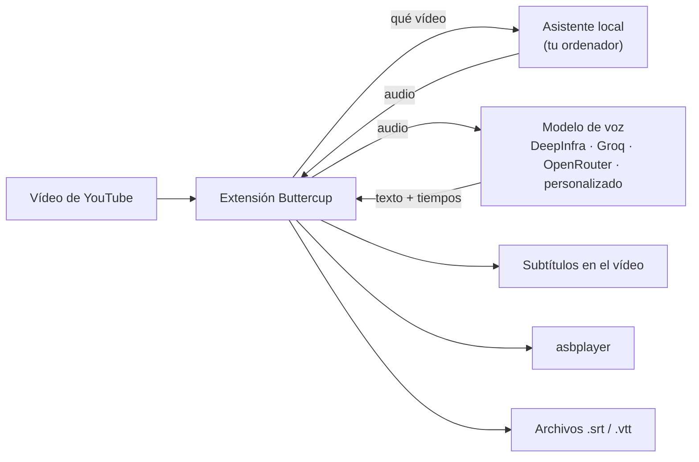

<div align="center">


# Buttercup Revival

**Transcripción de YouTube bajo demanda para navegadores Chromium y Gecko.**

Buttercup Revival es una extensión para navegadores basados en Chromium y navegadores Gecko como Firefox y Zen.
Transcribe el audio del vídeo que estás viendo con el modelo de voz que elijas
y muestra el resultado como subtítulos, lo envía a [asbplayer](https://github.com/asbplayer/asbplayer)
o lo guarda como archivo `.srt`.

[](https://github.com/arrow-poppa/buttercup-revival/actions/workflows/test.yml)
[](https://github.com/arrow-poppa/buttercup-revival/releases/latest)


[English](README.md) · [Português (Brasil)](README.pt-BR.md) · **Español** · [日本語](README.ja.md) · [简体中文](README.zh-CN.md) · [繁體中文](README.zh-TW.md)

[Instalación](#installation) · [Guía de Firefox / Zen](docs/es/GECKO_SETUP.md) · [Primeros subtítulos](#first-subtitles) · [asbplayer](#asbplayer) · [Ajustes](#settings) · [Solución de problemas](#troubleshooting) · [Desarrolladores](#developers)


</div>

---

## ✨ Qué hace

- **Subtítulos para vídeos que no tienen**, o cuyos subtítulos automáticos son deficientes.
- **Sigue al hablante.** Cada subtítulo termina con la frase, en una coma o en una pausa, para que el texto aparezca y desaparezca con el habla en lugar de en bloques fijos.
- **Tú eliges el modelo de voz.** DeepInfra, Groq, OpenRouter o cualquier API compatible con OpenAI. Whisper, Qwen ASR, Voxtral y otros.
- **Tres formas de usar el resultado:** subtítulos en el reproductor de YouTube, envío automático a **asbplayer** o archivos `.srt` / `.vtt` guardados en una carpeta que elijas.
- **Reutiliza transcripciones en caché.** Cambia el diseño de los subtítulos o vuelve a exportar sin otra solicitud al proveedor. Regenerar solicita explícitamente una transcripción nueva.
- **Preparación local del audio.** El asistente prepara el audio en tu ordenador; la extensión lo envía, junto con la clave de API necesaria, solo al proveedor de transcripción que hayas elegido.
- **Seis idiomas de interfaz:** English, Português, Español, 日本語, 简体中文, 繁體中文.

## 🧩 Cómo funciona

Buttercup tiene dos partes que el instalador configura juntas:

| Parte | Qué es | Qué hace |
| --- | --- | --- |
| **La extensión** | WebExtension para Chromium o Gecko | Añade el botón **BC** al reproductor de YouTube, se comunica con el modelo de voz y muestra y exporta los subtítulos |
| **El asistente local** | Un pequeño programa en tu ordenador | Obtiene el audio del vídeo con `yt-dlp` y lo prepara con FFmpeg |



El asistente solo se ejecuta cuando se lo pides y solo acepta conexiones de tu propio ordenador (`127.0.0.1`).

## 📋 Qué necesitas

- **Windows 10 u 11**, o **Linux**.
- **Un navegador de escritorio compatible:** Chromium 120+ (Chrome, Edge, Brave, Vivaldi, Opera, Chromium y derivados compatibles), o Gecko 140+ (Firefox, Zen y derivados modernos compatibles). Consulta la [compatibilidad con Chromium](docs/es/BROWSERS.md) y la [configuración de Firefox / Zen](docs/es/GECKO_SETUP.md).
- **Una clave de API** de un proveedor de voz. Crear una lleva un par de minutos; consulta el [paso 4](#step-4).
- Alrededor de **1 GB** de espacio libre en disco.

**No** necesitas instalar Python, Node.js ni FFmpeg por tu cuenta. El instalador lo hace.

## 🚀 Instalación

<a id="installation"></a>

Empieza por la ruta correspondiente a tu navegador. Las instalaciones nativas se conectan mediante la API de mensajería nativa del navegador. Zen Flatpak puede usar un lanzador automático opcional con Flatseal o un archivo de conexión manual.

| Navegador | Compilación | Guía de configuración |
| --- | --- | --- |
| Basado en Chromium | `dist/chromium` | Continúa con los pasos siguientes |
| Firefox / Zen / derivados modernos de Gecko | `dist/firefox` o `dist/firefox-unsigned.zip` | [Sigue la guía de Firefox / Zen](docs/es/GECKO_SETUP.md) |
| Zen Flatpak | Compilación Gecko | [Automática con Flatseal](docs/es/GECKO_SETUP.md#flatseal) o [conexión manual](docs/es/GECKO_SETUP.md#manual) |

### Paso 1 · Descarga

1. **[Descarga Buttercup (ZIP)](https://github.com/arrow-poppa/buttercup-revival/releases/latest/download/Buttercup-Revival.zip)**.
2. **Extrae** el ZIP: haz clic derecho → **Extraer todo…**
3. Coloca la carpeta extraída en un lugar donde pueda quedarse, por ejemplo **Documentos**.

> [!IMPORTANT]
> La extensión se ejecuta desde esta carpeta. Si la mueves o la eliminas más adelante, Buttercup dejará de funcionar.

> [!NOTE]
> A partir de la **v0.6.0**, el ZIP de la versión incluye ambas compilaciones de navegador: `dist/chromium`, `dist/firefox` y `dist/firefox-unsigned.zip`. Para Firefox/Zen, sigue la [guía de configuración de Gecko](docs/es/GECKO_SETUP.md), incluidos los requisitos de firma de tu navegador.

### Paso 2 · Ejecuta el instalador

<details open>
<summary><b>Windows</b></summary>

Abre la carpeta y haz doble clic en **`Install Buttercup.cmd`**.

Se abre una ventana que muestra cinco pasos mientras trabaja. Descarga e instala lo que falte,
así que la primera ejecución puede tardar unos minutos. Al terminar, abre la carpeta que necesitarás en el paso 3.

- Si Windows muestra **"Windows protegió tu PC"**, haz clic en **Más información** → **Ejecutar de todas formas**. Aparece con cualquier script descargado.
- Si una ventana pide permiso para instalar **Node.js**, elige **Sí**.

</details>

<details>
<summary><b>Linux</b></summary>

Abre un terminal en la carpeta y ejecuta:

```sh
sh install.sh
```

Usa tu gestor de paquetes (`apt`, `dnf`, `pacman` o `zypper`) y pide tu contraseña solo para instalar los paquetes que falten.

Para el inicio automático, usa un paquete nativo del navegador (`.deb` / `.rpm`). **Snap** y **Flatpak** pueden bloquear la mensajería nativa. Los usuarios de Zen Flatpak pueden seguir el [tutorial de conexión automática o manual](docs/es/GECKO_SETUP.md#connect).

</details>

### Paso 3 · Añade la extensión a tu navegador

**Firefox, Zen y otros navegadores Gecko modernos:** usa la [guía de instalación paso a paso](docs/es/GECKO_SETUP.md). Explica la instalación permanente sin firma en Zen, las diferencias entre las ediciones de Firefox y ambos métodos de conexión con Flatpak. **Helium en Linux** usa la compilación de Chromium; sus rutas de host nativo están registradas, pero la validación de Helium en ejecución sigue pendiente.

**Compilaciones Gecko sin firma:** Zen puede mantener instalada una extensión sin firma después de poner `xpinstall.signatures.required` en `false` en `about:config`. Las compilaciones estándar de Firefox Release siguen exigiendo firma; Firefox ESR, Developer Edition, Nightly, LibreWolf y Waterfox tienen políticas distintas. La guía incluye [requisitos de firma verificados y enlaces a las fuentes](docs/es/GECKO_SETUP.md#other-browsers).

Los pasos siguientes se aplican a los navegadores basados en Chromium.

Los navegadores solo instalan extensiones automáticamente desde su tienda, así que este paso se hace a mano.

1. Abre tu navegador basado en Chromium, escribe **`chrome://extensions`** en la barra de direcciones y pulsa Intro.
2. Activa el **Modo de desarrollador** (arriba a la derecha en Chrome, a la izquierda en Edge).
3. Haz clic en **Cargar descomprimida**.
4. Elige la carpeta **`dist/chromium`** dentro de la carpeta de Buttercup. En Windows, el instalador ya copió su dirección: pulsa **Ctrl + V** en la ventana de carpetas y luego **Seleccionar carpeta**.


Buttercup aparece ahora en la lista. Haz clic en el icono de pieza de puzle de la barra de herramientas y **fija** Buttercup para que su icono permanezca visible.

### Paso 4 · Añade tu clave de API

<a id="step-4"></a>

El modelo de voz se ejecuta en un proveedor, que necesita una clave para saber que la solicitud es tuya.

1. Crea una cuenta y una clave en uno de estos:

   | Proveedor | Conviene saber | Obtener una clave |
   | --- | --- | --- |
   | **Groq** | Tiene plan gratuito; rápido | [console.groq.com/keys](https://console.groq.com/keys) |
   | **DeepInfra** | Pago por uso; muchos modelos de voz (Whisper, Qwen ASR, Voxtral) | [deepinfra.com/dash/api_keys](https://deepinfra.com/dash/api_keys) |
   | **OpenRouter** | Una cuenta para muchos proveedores | [openrouter.ai/keys](https://openrouter.ai/keys) |

2. Haz clic en el **icono de Buttercup** en la barra de herramientas del navegador.
3. Conecta el asistente con **Start and connect** o con el [método Flatpak](docs/es/GECKO_SETUP.md#connect) que elijas. El indicador cambia a **Connected**.
4. En **Transcription**, elige tu proveedor y pega la clave.


Todo se guarda automáticamente. Ya está.

## 🎬 Tus primeros subtítulos

<a id="first-subtitles"></a>

1. Abre cualquier vídeo de YouTube.
2. Haz clic en el botón rosa **BC** de los controles del reproductor.
3. Un aviso morado muestra el progreso: extrayendo audio, transcribiendo, listo.
4. Los subtítulos aparecen en el vídeo. Haz clic de nuevo en **BC** para ocultarlos o mostrarlos.

La primera vez tarda aproximadamente lo que el proveedor necesita para transcribir el audio. Abrir el mismo vídeo más tarde es instantáneo, porque el resultado está en caché.

> [!TIP]
> Después de reiniciar el ordenador, abre la ventana emergente de Buttercup y haz clic una vez en **Start and connect**.

**Dos mensajes que puedes encontrar**

- *"Human captions are available"*: el vídeo ya tiene subtítulos escritos por una persona. Para sustituirlos de todos modos, desactiva **Prefer human captions** en **General**.
- *"Multiple audio tracks detected"*: el vídeo está doblado. Pon **Audio track for transcription** en **Original audio**. Puedes dejarlo así para todos los vídeos.

## 📚 Uso con asbplayer

<a id="asbplayer"></a>

Buttercup puede entregar sus subtítulos directamente a [asbplayer](https://github.com/asbplayer/asbplayer) para el estudio de idiomas.

Los dos se comunican mediante el **servidor WebSocket** de asbplayer, un pequeño programa del proyecto asbplayer que se ejecuta en tu ordenador. No forma parte de Buttercup y el instalador no lo configura, así que haz esto una vez:

**1 · Inicia el servidor WebSocket de asbplayer**

Instala [Go](https://go.dev/dl/) y [Git](https://git-scm.com/downloads), y luego ejecuta en un terminal:

```sh
git clone https://github.com/asbplayer/asbplayer.git
cd asbplayer/scripts/web-socket-server
go run .
```

Deja esa ventana abierta mientras usas asbplayer. La próxima vez solo harán falta las dos últimas líneas. La propia [guía del servidor WebSocket](https://docs.asbplayer.dev/docs/guides/web-socket-server) de asbplayer tiene los detalles y las opciones.

**2 · Permite que asbplayer se conecte**

Abre los ajustes de asbplayer, ve a **Misc** y activa el **WebSocket client**. Deja la dirección como está.

**3 · Indica a Buttercup que lo use**

En la ventana emergente de Buttercup, abre **Integrations · asbplayer**:

- Haz clic en **Check connected media** para confirmar que Buttercup puede llegar al servidor.
- Activa **Auto-send subtitles to asbplayer**.
- Para ver solo los subtítulos de asbplayer, desactiva **Show Buttercup captions on the YouTube video** en **General**.

A partir de entonces, pulsar **BC** genera los subtítulos y los carga en asbplayer. El botón **Send to asbplayer** los envía de nuevo en cualquier momento, incluso desde la caché.

## 💾 Guardar archivos de subtítulos

- **Download SRT** / **Download VTT** guardan los subtítulos del vídeo actual.
- **Save SRT automatically after generating** lo hace para cada vídeo.
- **Folder for subtitle files** elige dónde se guardan. Déjalo vacío para usar la carpeta Descargas del navegador, o escribe una ruta completa como `D:\Subtitles`. La carpeta debe existir ya.

Los archivos se nombran `[videoID]___Title.srt`, por ejemplo `[dQw4w9WgXcQ]___Never Gonna Give You Up.srt`. Un archivo más reciente sustituye a otro con el mismo nombre.

## 🔧 Ajustes

<a id="settings"></a>

La ventana emergente está organizada en secciones. Las que más probablemente uses:

| Sección | Ajuste | Qué hace |
| --- | --- | --- |
| **Header** | Language | Idioma de la interfaz. *Auto* sigue al navegador |
| **General** | Audio track for transcription | *Original audio* evita transcribir un doblaje |
| | Show Buttercup captions on the YouTube video | Desactivado = los subtítulos solo van a asbplayer o a archivos |
| | Spoken language | Déjalo vacío para detectarlo; configúralo (`ja`, `en`, `pt`…) si la detección falla |
| | Folder for subtitle files | Dónde se escriben los archivos `.srt` / `.vtt` |
| **Transcription** | Provider, key and model | Qué modelo de voz transcribe el audio |
| | Request word timestamps | Necesario para subtítulos cortos alineados con el habla. Mantenlo activado |
| | Vocabulary prompt | Nombres y palabras inusuales, para ayudar al modelo a escribirlos |
| **Subtitle layout** | Start a new subtitle | Seguir al hablante o cortar solo en el límite de palabras |
| | Max words per subtitle | El límite de texto que se muestra a la vez |
| | Line break every N words | Divide un subtítulo en líneas |
| **Audio upload (advanced)** | Audio sending | *In parts* funciona con cualquier duración; *Whole audio* es una sola solicitud |
| | Audio format | MP3 (predeterminado) o FLAC, recordado para cada configuración de proveedor/modelo |
| **Keyboard shortcuts** | Configure shortcuts | Personaliza Generate y Regenerate en los ajustes de atajos del navegador |
| **Backup** | Export / Import settings | Guarda tus ajustes en un archivo y cárgalos más tarde |

Los atajos de teclado funcionan en el vídeo activo de YouTube con la ventana emergente cerrada. Valores predeterminados: **Alt+Shift+G** genera usando la caché cuando está disponible; **Alt+Shift+U** regenera con una nueva solicitud al proveedor (pueden aplicarse cargos). Abre **Keyboard shortcuts → Configure shortcuts** en Buttercup para reasignarlos o desactivarlos. Chromium abre su página de atajos de extensiones; Firefox/Zen abre Manage Extension Shortcuts. El navegador guarda las asignaciones por separado de las copias de seguridad, y las combinaciones reservadas o en conflicto pueden quedar sin asignar o ser interceptadas por el navegador. Los eventos físicos de teclas se probaron bajo Xvfb en Chromium y Firefox, incluidas asignaciones personalizadas de Firefox; ejecuta las suites de navegador con `BUTTERCUP_TEST_SHORTCUTS=1` en una pantalla X11 aislada para reproducirlo.

En los modos de segmentación de Buttercup, los límites de palabras también se aplican cuando un proveedor devuelve solo marcas de tiempo de segmentos o coloca una frase entera en una sola entrada de palabra. En esos casos, los límites internos de los subtítulos se estiman dentro del segmento original y el mensaje de finalización lo explica; las marcas de tiempo reales de las palabras se conservan. El japonés y el chino usan caracteres de texto, manteniendo intactas las palabras latinas y los grafemas Unicode. Elige **Start a new subtitle → Keep provider segments (original timing)** para usar los límites de segmento devueltos. Esto omite el límite de palabras; pon **Line break** en **0** para conservar el diseño del texto devuelto. Cuando no se devuelven segmentos, se usan las entradas de palabras con marca de tiempo originales. Cambiar el diseño reformatea los subtítulos en caché sin llamar a un proveedor. **Regenerate subtitles** omite explícitamente las cachés local y comunitaria y solicita una transcripción nueva (pueden aplicarse cargos del proveedor); una solicitud fallida conserva el último resultado en caché.


Cambiar **Subtitle layout** nunca cuesta nada: reordena las palabras que ya se transcribieron.

<details>
<summary><b>Sobre el tamaño de las subidas y los vídeos largos</b></summary>

Los proveedores limitan el tamaño de cada archivo subido. Mantén **Max audio chunk (MB)** dentro del límite de tu proveedor; Buttercup usa 24 MB por defecto. MP3 a 64 kbps usa unos 0,48 MB por minuto. El tamaño de FLAC depende del audio, así que el mismo límite de subida puede abarcar una duración distinta.

Para cualquier cosa más larga, mantén **Audio sending** en **In parts**: el audio se corta en piezas que se solapan 1,5 segundos, cada pieza se transcribe por separado y los resultados se unen sin repetir ni perder palabras.

</details>

**Audio format** ofrece **MP3 — smaller uploads (default)** y **FLAC — lossless encoding, usually larger uploads**. Ambos usan audio **mono de 16 kHz**; MP3 usa **64 kbps** y FLAC usa **muestras de 16 bits**. Cada formato se codifica directamente desde la fuente descargada. FLAC evita un paso adicional de codificación con pérdida, pero no puede recuperar el detalle ya perdido en el audio de YouTube ni garantiza mejores transcripciones o marcas de tiempo.

Buttercup recuerda el formato por separado para cada proveedor, endpoint/modo de API, modelo y proveedor upstream fijado, incluso en las copias de seguridad de ajustes. Las instalaciones existentes y las copias antiguas usan MP3 por defecto. Ambas opciones siguen disponibles para todos los proveedores. La aceptación del formato depende de la API y el modelo seleccionados; las subidas rechazadas no se reintentan con otro formato ni otro proveedor. FLAC requiere el asistente local actualizado: ejecuta el instalador y reinicia el asistente después de actualizar.

Cambiar el formato **reutiliza los subtítulos en caché**. Elige **Regenerate subtitles** para enviar audio recién codificado en el formato seleccionado; pueden aplicarse cargos del proveedor. La prueba de muestra corta sube el archivo que selecciones sin modificarlo, así que usa una muestra ya codificada en el formato que quieras probar. No se afirma ninguna mejora de precisión ni se ha realizado una comparación con proveedores de pago.

<details>
<summary><b>Sobre las cookies y los vídeos restringidos</b></summary>

Los vídeos con restricción de edad o solo para miembros requieren que hayas iniciado sesión. En **YouTube Authentication / Cookies** puedes importar un archivo `cookies.txt` exportado de tu navegador. Solo se aceptan cookies de YouTube y Google, y permanecen en tu ordenador.

</details>

Para japonés, chino y otros sistemas de escritura compatibles sin espacios, el diseño de los subtítulos usa recuentos de caracteres en lugar de palabras separadas por espacios. Los tokens con marca de tiempo se unen sin espacios artificiales; las palabras latinas y los números se mantienen intactos en texto mixto. El ajuste de líneas conserva los grafemas Unicode y mantiene la puntuación de cierre con el texto anterior. Los límites de los subtítulos siguen las marcas de tiempo del proveedor: una frase larga devuelta como una sola entrada puede ocupar varias líneas, pero no recibe tiempos inventados por carácter.

## 🌍 Idiomas

La interfaz está disponible en **English, Português (Brasil), Español, 日本語, 简体中文 y 繁體中文**. Elige uno en el menú de la parte superior de la ventana emergente. Con la selección automática de idioma, se usa chino tradicional para las configuraciones regionales de Taiwán, Hong Kong, Macao y `zh-Hant`; una preferencia de escritura explícita tiene prioridad sobre la región.

Las traducciones están en [`locales/`](locales), un archivo por idioma, con el formato `"original text": "traducción"`. Todas las cadenas de origen y claves de traducción están en inglés. La descripción de la extensión y los instaladores siempre están en inglés. El texto sin traducción se muestra tal como se escribió, así que una entrada ausente nunca rompe nada. Para añadir un idioma, copia un archivo, traduce los valores y regístralo en [`api/i18n.js`](api/i18n.js).

## 🔄 Actualización

1. Descarga el [ZIP más reciente](https://github.com/arrow-poppa/buttercup-revival/releases/latest/download/Buttercup-Revival.zip) y extráelo **sobre la misma carpeta**, reemplazando los archivos.
2. Ejecuta el instalador de nuevo.
3. Abre `chrome://extensions` y haz clic en la flecha de **recarga** de la tarjeta de Buttercup.

Tus ajustes se quedan donde están. Para mayor seguridad, usa **Backup → Export settings** primero. Para restaurar una copia, elige **Backup → Import settings**. Buttercup abre una pestaña de ajustes; selecciona allí tu archivo JSON y haz clic en **Import settings**. Mantén la pestaña abierta hasta que termine la importación.

Todas las selecciones de archivos usan esta página persistente: **Test transcription and timestamps**, **Import cookies**, **Open connection editor** e **Import settings** abren la sección correspondiente en una pestaña. Elige el archivo allí y luego haz clic en el botón de prueba o importación. Cerrar la ventana emergente original o cambiar de pestaña mantiene disponible el archivo seleccionado. Abrir la página o seleccionar un archivo no lo envía; las pruebas de audio y las importaciones de cookies requieren tu envío explícito. La persistencia de cookies sigue desactivada a menos que la actives para esa importación.

## 🧹 Desinstalación

1. **Windows:** haz doble clic en **`Uninstall Buttercup.cmd`**. **Linux:** ejecuta `.venv/bin/python scripts/setup-assistant.py --uninstall`.
2. Elimina **Buttercup Revival** en `chrome://extensions`.
3. Borra la carpeta de Buttercup.

Python, Node.js y FFmpeg permanecen instalados, ya que otros programas pueden usarlos. Elimínalos de la lista de aplicaciones de tu sistema si quieres.

## 🛠 Solución de problemas

<a id="troubleshooting"></a>

| Qué ves | Qué hacer |
| --- | --- |
| El indicador del asistente dice **Disconnected** | Los navegadores nativos y el puente de Flatseal usan **Start and connect**. Las conexiones manuales de Flatpak usan **Start Buttercup assistant.sh** y luego **Check connection** |
| El navegador no puede llegar al asistente local | Ejecuta el instalador desde la carpeta extraída correcta. En Flatpak, completa el [método A o B](docs/es/GECKO_SETUP.md#connect); instalar solo el complemento no basta |
| No hay botón **BC** en el reproductor | Recarga la página de YouTube. Comprueba que **Enable Buttercup** esté activado |
| Aparece un botón **Reload extension** en la ventana emergente | Haz clic en él. La extensión se actualizó mientras estaba abierta |
| *"Set your … API key first"* | Pega la clave del proveedor seleccionado en **Transcription** |
| *"YouTube rejected extraction (403)"* o fallo de autenticación | Importa cookies nuevas o inténtalo más tarde; YouTube a veces bloquea las descargas temporalmente |
| Los subtítulos son bloques enormes de texto | Selecciona un modo de segmentación de Buttercup y reduce **Max words per subtitle**. La segmentación original del proveedor omite ese límite. Si no hay tiempos por palabra, los tiempos internos se estiman |
| *"asbplayer is unavailable"* | Inicia el servidor WebSocket de asbplayer y activa el cliente WebSocket en asbplayer; consulta [Uso con asbplayer](#asbplayer) |
| La subida se rechaza por ser demasiado grande | Usa **Audio sending → In parts** |
| El instalador dice que no se pudo instalar un programa | Instálalo a mano ([Python](https://www.python.org/downloads/), [Node.js](https://nodejs.org/), [FFmpeg](https://ffmpeg.org/download.html)) y ejecuta el instalador de nuevo |
| No pasa nada y no hay ningún mensaje | Abre la ventana emergente: la línea de estado de la parte superior muestra el último error |

¿Sigues atascado? [Abre una incidencia](https://github.com/arrow-poppa/buttercup-revival/issues) con el mensaje que ves y los pasos que llevaron a él.

## 🔒 Privacidad y seguridad

- **El audio** se descarga y se convierte en tu ordenador, y luego se envía solo al proveedor que hayas elegido.
- **Las claves de API** se guardan en el almacenamiento privado de la extensión y solo se envían a ese proveedor. La página de YouTube nunca las ve.
- **El asistente local** acepta conexiones solo desde tu ordenador y solo desde esta extensión, mediante un token aleatorio creado durante la instalación.
- **Configuración del asistente por usuario.** El asistente vive en la carpeta de Buttercup y se registra por usuario. El instalador puede usar el gestor de paquetes del sistema para las dependencias que falten; el asistente no tiene inicio de sesión automático.
- **Sin telemetría.** La caché comunitaria opcional está desactivada por defecto y, cuando se activa, solo comparte el texto de los subtítulos y los detalles del vídeo y del modelo.

Una copia de seguridad de los ajustes contiene tus claves de API. Trata ese archivo como una contraseña.

## 👩‍💻 Para desarrolladores

<a id="developers"></a>

<details>
<summary><b>Estructura del proyecto</b></summary>

```
manifest.json, popup.html      Manifiesto de la extensión y ventana emergente
buttercup.js, content.js       Botón del reproductor, subtítulos y aviso de progreso (scripts de contenido)
background/, gecko/            Procesamiento compartido y compatibilidad Chromium/Gecko
api/                           Ajustes, proveedores, canal de transcripción, i18n
subtitles/, cache/             Formato de subtítulos, exportación SRT/VTT, caché IndexedDB
integrations/                  asbplayer
locales/                       Traducciones de la interfaz (claves de origen en inglés)
backend/                       Asistente local (FastAPI, yt-dlp, pytubefix, FFmpeg)
scripts/                       Instaladores, puente de mensajería nativa, compilación y pruebas de navegador
tests/                         Pruebas unitarias de Node y pytest
docs/                          Notas técnicas, análisis del proyecto original, registro de validación
```

</details>

<details>
<summary><b>Compilación y pruebas</b></summary>

Requiere Python 3.11+, Node.js 22+ y FFmpeg. Cada ejecución del instalador pide a pip que actualice yt-dlp y pytubefix a las últimas versiones estables compatibles con el Python instalado y los requisitos de dependencias.

```sh
python -m venv .venv
.venv/bin/python -m pip install -r backend/requirements-dev.txt   # Windows: .venv\Scripts\python.exe
npm ci

npm run build                       # genera dist/chromium, dist/firefox y dist/firefox-unsigned.zip
npm run package                     # compila el archivo de la versión, dist/Buttercup-Revival.zip
npm test                            # pruebas unitarias de JavaScript
.venv/bin/python -m pytest tests/backend -q
```

La extensión no tiene bundler: `npm run build` copia los archivos compartidos y aplica las pequeñas adaptaciones de manifiesto/API/almacenamiento de Gecko. `node scripts/build.mjs` es todo lo que necesita el instalador. Consulta la [arquitectura Gecko y la validación en ejecución](docs/firefox.md).

</details>

<details>
<summary><b>Notas de diseño</b></summary>

- **Chromium Manifest V3; Gecko Manifest V2 con una página de fondo persistente oculta.** Sin código remoto. Los subtítulos usan el `TextTrack` nativo del vídeo.
- **Identidades estables de la extensión.** Chromium deriva su ID de la clave pública del manifiesto; Gecko usa un ID de complemento explícito. El instalador registra ambos automáticamente.
- **Puente de mensajería nativa** con una única acción permitida: iniciar el servicio local y devolver su token de emparejamiento.
- **Las solicitudes al proveedor nunca se reintentan ni se redirigen** tras un fallo, para que una solicitud de pago no se repita en silencio.
- Más detalles (en portugués): [notas técnicas](docs/TECHNICAL.pt-BR.md), [cambios respecto al proyecto original](docs/CHANGES.md), [registro de validación](docs/VALIDATION.md).

</details>

Las contribuciones son bienvenidas. Ejecuta las pruebas unitarias antes de abrir una solicitud de cambios.

## 🙏 Créditos

Buttercup Revival es un fork modernizado de **[Buttercup](https://github.com/iGerman00/buttercup-chrome), de iGerman00**, que creó la idea, el nombre y el aspecto. Si te resulta útil, considera [apoyar al autor original](https://github.com/iGerman00).

Construido sobre [yt-dlp](https://github.com/yt-dlp/yt-dlp), [pytubefix](https://github.com/JuanBindez/pytubefix), [FFmpeg](https://ffmpeg.org/) y [FastAPI](https://fastapi.tiangolo.com/).

El proyecto original no declara una licencia, y este fork no añade ninguna; consulta [docs/UPSTREAM.md](docs/UPSTREAM.md).
