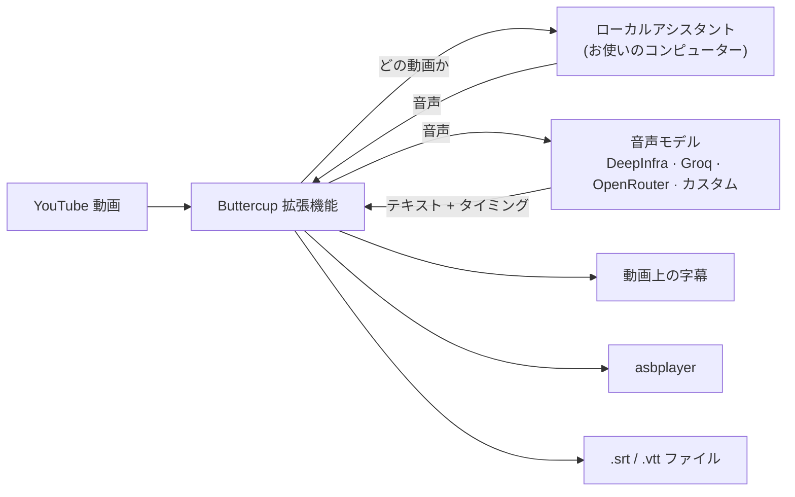

<div align="center">


# Buttercup Revival

**Chromium 系と Gecko 系ブラウザ向けの、必要なときだけ使う YouTube 文字起こし。**

Buttercup Revival は、Chromium 系ブラウザと Firefox、Zen などの Gecko 系ブラウザ向けの拡張機能です。
視聴中の動画の音声を、選んだ音声モデルで文字起こしし、
結果を字幕として表示するか、[asbplayer](https://github.com/asbplayer/asbplayer) に送信するか、
`.srt` ファイルとして保存します。

[](https://github.com/arrow-poppa/buttercup-revival/actions/workflows/test.yml)
[](https://github.com/arrow-poppa/buttercup-revival/releases/latest)


[English](README.md) · [Português (Brasil)](README.pt-BR.md) · [Español](README.es.md) · **日本語** · [简体中文](README.zh-CN.md) · [繁體中文](README.zh-TW.md)

[インストール](#installation) · [Firefox / Zen ガイド](docs/ja/GECKO_SETUP.md) · [最初の字幕](#first-subtitles) · [asbplayer](#asbplayer) · [設定](#settings) · [トラブルシューティング](#troubleshooting) · [開発者向け](#developers)


</div>

---

## ✨ できること

- **字幕がない動画**、または自動字幕の品質が低い動画に字幕を付けます。
- **話し手に合わせます。** 各字幕は文末、読点、または息継ぎの位置で終わるため、固定ブロックではなく発話に合わせてテキストが表示され、消えます。
- **音声モデルは自分で選べます。** DeepInfra、Groq、OpenRouter、または OpenAI 互換 API。Whisper、Qwen ASR、Voxtral など。
- **結果の使い方は 3 通り:** YouTube プレーヤー上の字幕、**asbplayer** への自動送信、選択したフォルダーへの `.srt` / `.vtt` ファイル保存。
- **キャッシュ済みの文字起こしを再利用。** 字幕レイアウトの変更や再エクスポートに、追加のプロバイダーリクエストは不要です。再生成は明示的に新しい文字起こしを要求します。
- **音声はローカルで準備。** アシスタントがお使いのコンピューターで音声を準備し、拡張機能は音声と必要な API キーを、選択した文字起こしプロバイダーにのみ送信します。
- **6 つのインターフェース言語:** English、Português、Español、日本語、简体中文、繁體中文。

## 🧩 仕組み

Buttercup は、インストーラーがまとめてセットアップする 2 つの部分で構成されます:

| 部分 | 内容 | 役割 |
| --- | --- | --- |
| **拡張機能** | Chromium または Gecko の WebExtension | YouTube プレーヤーに **BC** ボタンを追加し、音声モデルと通信し、字幕を表示・エクスポートします |
| **ローカルアシスタント** | コンピューター上の小さなプログラム | `yt-dlp` で動画の音声を取得し、FFmpeg で準備します |



アシスタントは要求したときだけ実行され、自分のコンピューター (`127.0.0.1`) からの接続だけを受け付けます。

## 📋 必要なもの

- **Windows 10 または 11**、または **Linux**。
- **対応するデスクトップブラウザ:** Chromium 120+ (Chrome、Edge、Brave、Vivaldi、Opera、Chromium および互換フォーク)、または Gecko 140+ (Firefox、Zen および互換のモダンフォーク)。[Chromium の互換性](docs/ja/BROWSERS.md)と [Firefox / Zen のセットアップ](docs/ja/GECKO_SETUP.md)を参照してください。
- **API キー** (音声プロバイダーのもの)。作成には数分かかります。[ステップ 4](#step-4) を参照してください。
- 約 **1 GB** の空きディスク容量。

Python、Node.js、FFmpeg を自分でインストールする必要は**ありません**。インストーラーが行います。

## 🚀 インストール

<a id="installation"></a>

まず、お使いのブラウザに合った方法を選んでください。ネイティブインストールはブラウザのネイティブメッセージング API で接続します。Zen Flatpak は、Flatseal を使う任意の自動ランチャー、または手動の接続ファイルを利用できます。

| ブラウザ | ビルド | セットアップガイド |
| --- | --- | --- |
| Chromium 系 | `dist/chromium` | 以下の手順に進んでください |
| Firefox / Zen / モダンな Gecko フォーク | `dist/firefox` または `dist/firefox-unsigned.zip` | [Firefox / Zen ガイドに従ってください](docs/ja/GECKO_SETUP.md) |
| Zen Flatpak | Gecko ビルド | [Flatseal による自動接続](docs/ja/GECKO_SETUP.md#flatseal)または[手動接続](docs/ja/GECKO_SETUP.md#manual) |

### ステップ 1 · ダウンロード

1. **[Buttercup (ZIP) をダウンロード](https://github.com/arrow-poppa/buttercup-revival/releases/latest/download/Buttercup-Revival.zip)**します。
2. ZIP を**展開**します: 右クリック → **すべて展開…**
3. 展開したフォルダーを、そのまま置いておける場所 (例: **ドキュメント**) に置きます。

> [!IMPORTANT]
> 拡張機能はこのフォルダーから実行されます。後で移動または削除すると、Buttercup は動作しなくなります。

> [!NOTE]
> **v0.6.0** 以降、リリース ZIP には両方のブラウザービルド (`dist/chromium`、`dist/firefox`、`dist/firefox-unsigned.zip`) が含まれます。Firefox/Zen では、お使いのブラウザの署名要件を含め、[Gecko セットアップガイド](docs/ja/GECKO_SETUP.md)に従ってください。

### ステップ 2 · インストーラーを実行

<details open>
<summary><b>Windows</b></summary>

フォルダーを開き、**`Install Buttercup.cmd`** をダブルクリックします。

ウィンドウが開き、処理中に 5 つのステップが表示されます。不足しているものをダウンロードしてインストールするため、
初回は数分かかることがあります。完了すると、ステップ 3 で必要になるフォルダーが開きます。

- **「Windows によって PC が保護されました」** と表示されたら、**詳細情報** → **実行** をクリックします。ダウンロードしたスクリプトでは常に表示されます。
- **Node.js** のインストール許可を求められたら、**はい** を選択します。

</details>

<details>
<summary><b>Linux</b></summary>

フォルダーでターミナルを開き、次を実行します:

```sh
sh install.sh
```

パッケージマネージャー (`apt`、`dnf`、`pacman`、`zypper`) を使用し、不足しているパッケージのインストール時のみパスワードを求めます。

自動起動には、ネイティブのブラウザパッケージ (`.deb` / `.rpm`) を使用してください。**Snap** と **Flatpak** はネイティブメッセージングをブロックする場合があります。Zen Flatpak のユーザーは[自動または手動接続のチュートリアル](docs/ja/GECKO_SETUP.md#connect)に従えます。

</details>

### ステップ 3 · ブラウザに拡張機能を追加

**Firefox、Zen、その他のモダンな Gecko ブラウザ:** [ステップバイステップのインストールガイド](docs/ja/GECKO_SETUP.md)を使用してください。Zen での未署名拡張機能の永続インストール、Firefox 各エディションの違い、Flatpak の 2 つの接続方法を説明しています。**Linux の Helium** は Chromium ビルドを使用します。ネイティブホストのパスは登録されますが、Helium の実行時検証はまだ保留中です。

**未署名の Gecko ビルド:** Zen では、`about:config` で `xpinstall.signatures.required` を `false` に設定すると、未署名の拡張機能をインストールしたままにできます。標準の Firefox リリースビルドは依然として署名を要求します。Firefox ESR、Developer Edition、Nightly、LibreWolf、Waterfox はそれぞれ異なるポリシーを持っています。ガイドには[検証済みの署名要件とソースへのリンク](docs/ja/GECKO_SETUP.md#other-browsers)があります。

以下の手順は Chromium 系ブラウザに適用されます。

ブラウザはストアからのみ拡張機能を自動インストールするため、この手順は手動で行います。

1. Chromium 系ブラウザを開き、アドレスバーに **`chrome://extensions`** と入力して Enter を押します。
2. **デベロッパー モード**をオンにします (Chrome では右上、Edge では左側)。
3. **パッケージ化されていない拡張機能を読み込む**をクリックします。
4. Buttercup フォルダー内の **`dist/chromium`** フォルダーを選択します。Windows ではインストーラーがアドレスをコピー済みです: フォルダー選択ウィンドウで **Ctrl + V** を押し、**フォルダーの選択**をクリックします。


Buttercup が一覧に表示されます。ツールバーのパズルピースのアイコンをクリックし、Buttercup を**ピン留め**してアイコンを常に表示させます。

### ステップ 4 · API キーを追加

<a id="step-4"></a>

音声モデルはプロバイダー上で動作し、リクエストがあなたのものであることを確認するためにキーが必要です。

1. 次のいずれかでアカウントとキーを作成します:

   | プロバイダー | 補足 | キーの取得 |
   | --- | --- | --- |
   | **Groq** | 無料枠あり、高速 | [console.groq.com/keys](https://console.groq.com/keys) |
   | **DeepInfra** | 従量課金、多数の音声モデル (Whisper、Qwen ASR、Voxtral) | [deepinfra.com/dash/api_keys](https://deepinfra.com/dash/api_keys) |
   | **OpenRouter** | 1 つのアカウントで多数のプロバイダーを利用 | [openrouter.ai/keys](https://openrouter.ai/keys) |

2. ブラウザのツールバーにある **Buttercup アイコン**をクリックします。
3. **Start and connect**、または選択した [Flatpak の方法](docs/ja/GECKO_SETUP.md#connect)でアシスタントを接続します。バッジが **Connected** に変わります。
4. **Transcription** でプロバイダーを選び、キーを貼り付けます。


すべて自動的に保存されます。以上で完了です。

## 🎬 最初の字幕

<a id="first-subtitles"></a>

1. 任意の YouTube 動画を開きます。
2. プレーヤーコントロールのピンク色の **BC** ボタンをクリックします。
3. 紫色の通知に進捗 (音声の抽出、文字起こし、完了) が表示されます。
4. 動画に字幕が表示されます。**BC** をもう一度クリックすると、表示/非表示を切り替えられます。

初回は、プロバイダーが音声を文字起こしするのにかかる時間とほぼ同じだけかかります。同じ動画を後で開くと、結果がキャッシュされているため即座に表示されます。

> [!TIP]
> コンピューターを再起動した後は、Buttercup のポップアップを開き、**Start and connect** を 1 回クリックしてください。

**表示される可能性のある 2 つのメッセージ**

- *"Human captions are available"*: 動画にはすでに人が作成した字幕があります。それでも置き換えるには、**General** の **Prefer human captions** をオフにします。
- *"Multiple audio tracks detected"*: 動画が吹き替え版です。**Audio track for transcription** を **Original audio** に設定します。すべての動画でそのままにしておけます。

## 📚 asbplayer と一緒に使う

<a id="asbplayer"></a>

Buttercup は字幕を [asbplayer](https://github.com/asbplayer/asbplayer) に直接渡し、語学学習に利用できます。

両者は asbplayer の **WebSocket サーバー**を通じて通信します。これは asbplayer プロジェクトの小さなプログラムで、お使いのコンピューター上で動作します。Buttercup の一部ではなく、インストーラーもセットアップしないため、次の作業を一度だけ行ってください:

**1 · asbplayer の WebSocket サーバーを起動**

[Go](https://go.dev/dl/) と [Git](https://git-scm.com/downloads) をインストールし、ターミナルで実行します:

```sh
git clone https://github.com/asbplayer/asbplayer.git
cd asbplayer/scripts/web-socket-server
go run .
```

asbplayer を使用している間は、そのウィンドウを開いたままにしてください。次回からは最後の 2 行だけが必要です。asbplayer 自身の [WebSocket サーバーガイド](https://docs.asbplayer.dev/docs/guides/web-socket-server)に詳細とオプションがあります。

**2 · asbplayer から接続できるようにする**

asbplayer の設定を開き、**Misc** に移動して **WebSocket client** を有効にします。アドレスはそのままにします。

**3 · Buttercup に使用を指示する**

Buttercup のポップアップで **Integrations · asbplayer** を開きます:

- **Check connected media** をクリックして、Buttercup がサーバーに到達できることを確認します。
- **Auto-send subtitles to asbplayer** をオンにします。
- asbplayer の字幕だけを表示するには、**General** の **Show Buttercup captions on the YouTube video** をオフにします。

以後、**BC** を押すと字幕が生成され、asbplayer に読み込まれます。**Send to asbplayer** ボタンは、キャッシュからでもいつでも再送信できます。

## 💾 字幕ファイルの保存

- **Download SRT** / **Download VTT** は現在の動画の字幕を保存します。
- **Save SRT automatically after generating** はすべての動画で自動保存します。
- **Folder for subtitle files** は保存先を選択します。空欄にするとブラウザーのダウンロードフォルダーを使用します。`D:\Subtitles` のようなフルパスを入力することもできます。フォルダーは事前に存在している必要があります。

ファイル名は `[videoID]___Title.srt` (例: `[dQw4w9WgXcQ]___Never Gonna Give You Up.srt`) です。同じ名前の古いファイルは新しいファイルで置き換えられます。

## 🔧 設定

<a id="settings"></a>

ポップアップはセクションに分かれています。よく使う可能性が高いものは次のとおりです:

| セクション | 設定 | 内容 |
| --- | --- | --- |
| **Header** | Language | インターフェースの言語。*Auto* はブラウザーに従います |
| **General** | Audio track for transcription | *Original audio* は吹き替えの文字起こしを避けます |
| | Show Buttercup captions on the YouTube video | オフ = 字幕は asbplayer またはファイルにのみ送られます |
| | Spoken language | 空欄で自動検出。検出が誤る場合は設定します (`ja`、`en`、`pt`…) |
| | Folder for subtitle files | `.srt` / `.vtt` ファイルの書き込み先 |
| **Transcription** | Provider, key and model | 音声を文字起こしする音声モデル |
| | Request word timestamps | 短く発話に沿った字幕に必要です。オンのままにしてください |
| | Vocabulary prompt | 固有名詞や珍しい単語をモデルが正しく綴るためのヒント |
| **Subtitle layout** | Start a new subtitle | 話し手に従うか、単語数上限でのみ区切るか |
| | Max words per subtitle | 一度に画面に表示するテキストの上限 |
| | Line break every N words | 字幕を N 語ごとに改行します |
| **Audio upload (advanced)** | Audio sending | *In parts* は任意の長さに対応。*Whole audio* は 1 回のリクエスト |
| | Audio format | MP3 (既定) または FLAC。プロバイダー/モデルの構成ごとに記憶されます |
| **Keyboard shortcuts** | Configure shortcuts | ブラウザーのショートカット設定で Generate と Regenerate をカスタマイズします |
| **Backup** | Export / Import settings | 設定をファイルに保存し、後で読み込みます |

キーボードショートカットは、ポップアップを閉じた状態でアクティブな YouTube 動画に対して機能します。既定値: **Alt+Shift+G** は利用可能な場合はキャッシュを使って生成します。**Alt+Shift+U** はプロバイダーへの新しいリクエストで再生成します (料金が発生する場合があります)。Buttercup の **Keyboard shortcuts → Configure shortcuts** を開くと、再割り当てまたは無効化できます。Chromium は拡張機能のショートカットページを開き、Firefox/Zen は Manage Extension Shortcuts を開きます。ブラウザーは割り当てを設定バックアップとは別に保存するため、予約済みまたは競合する組み合わせは未割り当てのままになるか、ブラウザーに横取りされることがあります。物理キーイベントは Xvfb 上の Chromium と Firefox で、Firefox のカスタム割り当てを含めてテスト済みです。再現するには、隔離された X11 ディスプレイで `BUTTERCUP_TEST_SHORTCUTS=1` を指定してブラウザースイートを実行してください。

Buttercup のセグメンテーションモードでは、プロバイダーがセグメントのタイムスタンプのみを返す場合や、フレーズ全体を 1 つの単語エントリに入れる場合にも、字幕の単語数上限が適用されます。その場合、内部のキュー境界は元のセグメント内で推定され、完了メッセージでその旨が説明されます。実際の単語タイムスタンプは保持されます。日本語/中国語はテキスト文字数を使用し、ラテン文字の単語と Unicode グラフェムはそのまま維持します。返されたセグメント境界を使用するには、**Start a new subtitle → Keep provider segments (original timing)** を選択します。これは単語数上限をバイパスします。返されたテキストレイアウトを維持するには、**Line break** を **0** に設定します。セグメントが返されなかった場合は、元のタイムスタンプ付き単語エントリが使用されます。レイアウトを変更すると、プロバイダーを呼び出さずにキャッシュ済み字幕が再フォーマットされます。**Regenerate subtitles** はローカルおよびコミュニティキャッシュを明示的にバイパスし、新しい文字起こしを要求します (プロバイダー料金が発生する場合があります)。リクエストが失敗した場合は、最後にキャッシュされた結果が保持されます。


**Subtitle layout** の変更には費用がかかりません。すでに文字起こしされた単語を並べ替えるだけです。

<details>
<summary><b>アップロードサイズと長い動画について</b></summary>

プロバイダーは 1 つのアップロードファイルのサイズを制限します。**Max audio chunk (MB)** はプロバイダーの許容範囲内に保ってください。Buttercup の既定値は 24 MB です。64 kbps の MP3 は 1 分あたり約 0.48 MB を使用します。FLAC のサイズは音声によって異なるため、同じアップロード上限でも対応できる長さが変わります。

それより長い場合は、**Audio sending** を **In parts** のままにしてください。音声は 1.5 秒重複するピースに分割され、各ピースが個別に文字起こしされ、単語を繰り返したり失ったりせずに結果が結合されます。

</details>

**Audio format** には **MP3 — smaller uploads (default)** と **FLAC — lossless encoding, usually larger uploads** があります。どちらも **16 kHz モノラル**音声を使用し、MP3 は **64 kbps**、FLAC は **16 ビットサンプル**です。各形式はダウンロードしたソースから直接エンコードされます。FLAC は追加の非可逆エンコード工程を避けますが、YouTube の音声ですでに失われた詳細を復元することはできず、より良い文字起こしやタイムスタンプを保証するものでもありません。

Buttercup は形式を、プロバイダー、API エンドポイント/モード、モデル、固定されたアップストリームプロバイダーごとに個別に記憶し、設定バックアップにも含めます。既存のインストールと古いバックアップは MP3 が既定です。どちらのオプションもすべてのプロバイダーで選択できます。形式の受け入れ可否は選択した API/モデルによって異なります。拒否されたアップロードは、別の形式やプロバイダーで再試行されません。FLAC には更新されたローカルアシスタントが必要です。更新後はインストーラーを実行し、アシスタントを再起動してください。

形式を変更すると、**キャッシュ済みの字幕が再利用されます**。選択した形式で新しくエンコードした音声を送信するには、**Regenerate subtitles** を選択してください (プロバイダー料金が発生する場合があります)。短いサンプルテストは選択したファイルをそのままアップロードするため、テストしたい形式でエンコード済みのサンプルを使用してください。精度の向上や有料プロバイダーでのベンチマークは主張していません。

<details>
<summary><b>Cookie と制限付き動画について</b></summary>

年齢制限付きまたはメンバー限定の動画では、サインインが必要です。**YouTube Authentication / Cookies** で、ブラウザーからエクスポートした `cookies.txt` ファイルをインポートできます。YouTube と Google の Cookie のみが受け入れられ、お使いのコンピューターに留まります。

</details>

日本語、中国語、その他のスペースを使わない対応スクリプトでは、字幕レイアウトはスペース区切りの単語ではなく文字数を使用します。タイムスタンプ付きトークンは人工的なスペースなしで結合され、混在テキスト内のラテン文字の単語と数字はそのまま維持されます。行の折り返しは Unicode グラフェムを保持し、閉じ句読点を前のテキストに付けます。字幕の境界は依然としてプロバイダーのタイムスタンプに従います。1 つのタイムスタンプ付きエントリとして返された長いフレーズは複数行に折り返すことがありますが、文字ごとの架空の時刻は割り当てられません。

## 🌍 言語

インターフェースは **English、Português (Brasil)、Español、日本語、简体中文、繁體中文** で利用できます。ポップアップ上部のメニューから選択してください。自動言語選択では、台湾、香港、マカオ、および `zh-Hant` のブラウザーロケールに繁体字中国語が使用されます。明示的なスクリプト設定は地域より優先されます。

翻訳は [`locales/`](locales) にあり、言語ごとに 1 ファイル、`"original text": "翻訳"` の形式です。すべてのソース文字列と翻訳キーは英語です。拡張機能の説明とインストーラーは常に英語です。翻訳のないテキストは書かれたまま表示されるため、エントリが欠けても何も壊れません。言語を追加するには、ファイルをコピーして値を翻訳し、[`api/i18n.js`](api/i18n.js) に登録します。

## 🔄 更新

1. [最新の ZIP](https://github.com/arrow-poppa/buttercup-revival/releases/latest/download/Buttercup-Revival.zip) をダウンロードし、**同じフォルダーに上書き**して展開します。
2. インストーラーを再度実行します。
3. `chrome://extensions` を開き、Buttercup カードの**再読み込み**矢印をクリックします。

設定はそのまま残ります。安全のため、先に **Backup → Export settings** を使用してください。バックアップを復元するには、**Backup → Import settings** を選択します。Buttercup が設定タブを開くので、そこで JSON ファイルを選択し、**Import settings** をクリックします。インポートが完了するまでタブを開いたままにしてください。

すべてのファイル選択はこの永続ページを使用します: **Test transcription and timestamps**、**Import cookies**、**Open connection editor**、**Import settings** はそれぞれ該当するセクションをタブで開きます。そこでファイルを選択し、テスト/インポートボタンをクリックします。元のポップアップを閉じたりタブを切り替えたりしても、選択したファイルは利用可能なままです。ページを開いたりファイルを選択したりするだけでは送信されません。音声テストと Cookie のインポートには明示的な送信が必要です。Cookie の永続化は、そのインポートで有効にしない限りオフのままです。

## 🧹 アンインストール

1. **Windows:** **`Uninstall Buttercup.cmd`** をダブルクリックします。**Linux:** `.venv/bin/python scripts/setup-assistant.py --uninstall` を実行します。
2. `chrome://extensions` で **Buttercup Revival** を削除します。
3. Buttercup フォルダーを削除します。

Python、Node.js、FFmpeg は他のプログラムが使用する可能性があるため、インストールされたままになります。必要ならシステムのアプリ一覧から削除してください。

## 🛠 トラブルシューティング

<a id="troubleshooting"></a>

| 表示される内容 | 対処方法 |
| --- | --- |
| アシスタントのバッジが **Disconnected** | ネイティブブラウザーと Flatseal ブリッジでは **Start and connect** を使用します。手動の Flatpak 接続では **Start Buttercup assistant.sh** を実行してから **Check connection** をクリックします |
| ブラウザーがローカルアシスタントに到達できない | 正しい展開済みフォルダーからインストーラーを実行してください。Flatpak では[方法 A または B](docs/ja/GECKO_SETUP.md#connect)を完了してください。アドオンをインストールするだけでは不十分です |
| プレーヤーに **BC** ボタンがない | YouTube ページを再読み込みしてください。**Enable Buttercup** がオンになっていることを確認します |
| ポップアップに **Reload extension** ボタンが表示される | クリックしてください。開いている間に拡張機能が更新されました |
| *"Set your … API key first"* | **Transcription** で選択したプロバイダーのキーを貼り付けてください |
| *"YouTube rejected extraction (403)"* または認証失敗 | 新しい Cookie をインポートするか、後で再試行してください。YouTube はダウンロードを一時的にブロックすることがあります |
| 字幕が巨大なテキストの塊になる | Buttercup のセグメンテーションモードを選択し、**Max words per subtitle** を下げてください。プロバイダー本来のセグメンテーションはこの上限をバイパスします。単語のタイミングがない場合は、内部のキューの時刻が推定されます |
| *"asbplayer is unavailable"* | asbplayer の WebSocket サーバーを起動し、asbplayer で WebSocket クライアントを有効にしてください。[asbplayer と一緒に使う](#asbplayer)を参照してください |
| アップロードが大きすぎると拒否される | **Audio sending → In parts** を使用してください |
| インストーラーがプログラムをインストールできなかったと表示する | 手動でインストールし ([Python](https://www.python.org/downloads/)、[Node.js](https://nodejs.org/)、[FFmpeg](https://ffmpeg.org/download.html))、インストーラーを再実行してください |
| 何も起こらず、メッセージもない | ポップアップを開いてください。上部のステータス行に最後のエラーが表示されます |

まだ解決しませんか? 表示されたメッセージと、そこに至るまでの手順を添えて[イシューを開いてください](https://github.com/arrow-poppa/buttercup-revival/issues)。

## 🔒 プライバシーとセキュリティ

- **音声**はお使いのコンピューターでダウンロードおよび変換され、選択したプロバイダーにのみ送信されます。
- **API キー**は拡張機能のプライベートストレージに保存され、そのプロバイダーにのみ送信されます。YouTube ページがキーを目にすることはありません。
- **ローカルアシスタント**は、インストール時に作成されるランダムなトークンを使用し、お使いのコンピューターから、この拡張機能からのみ接続を受け付けます。
- **ユーザーごとのアシスタントセットアップ。** アシスタントは Buttercup フォルダーにあり、ユーザーごとに登録されます。インストーラーは不足している依存関係にシステムのパッケージマネージャーを使用する場合があります。アシスタントの自動ログイン起動はありません。
- **テレメトリーなし。** 任意のコミュニティキャッシュは既定でオフで、有効にした場合は字幕テキストと動画/モデルの詳細のみを共有します。

設定バックアップには API キーが含まれます。そのファイルはパスワードのように扱ってください。

## 👩‍💻 開発者向け

<a id="developers"></a>

<details>
<summary><b>プロジェクト構成</b></summary>

```
manifest.json, popup.html      拡張機能のマニフェストとポップアップ
buttercup.js, content.js       プレーヤーのボタン、字幕、進捗通知 (コンテンツスクリプト)
background/, gecko/            共通処理と Chromium/Gecko の互換性
api/                           設定、プロバイダー、文字起こしパイプライン、i18n
subtitles/, cache/             キュー整形、SRT/VTT エクスポート、IndexedDB キャッシュ
integrations/                  asbplayer
locales/                       インターフェース翻訳 (英語のソースキー)
backend/                       ローカルアシスタント (FastAPI、yt-dlp、pytubefix、FFmpeg)
scripts/                       インストーラー、ネイティブメッセージングブリッジ、ビルド、ブラウザーテスト
tests/                         Node と pytest のユニットテスト
docs/                          技術ノート、アップストリーム分析、検証ログ
```

</details>

<details>
<summary><b>ビルドとテスト</b></summary>

Python 3.11+、Node.js 22+、FFmpeg が必要です。インストーラーを実行するたびに、pip を通じて yt-dlp と pytubefix を、インストール済みの Python と依存関係の要件に適合する最新の安定版へ更新します。

```sh
python -m venv .venv
.venv/bin/python -m pip install -r backend/requirements-dev.txt   # Windows: .venv\Scripts\python.exe
npm ci

npm run build                       # dist/chromium、dist/firefox、dist/firefox-unsigned.zip を生成
npm run package                     # リリースアーカイブ dist/Buttercup-Revival.zip をビルド
npm test                            # JavaScript ユニットテスト
.venv/bin/python -m pytest tests/backend -q
```

この拡張機能にはバンドラーがありません: `npm run build` は共有ファイルをコピーし、Gecko 向けの小さなマニフェスト/API/ストレージの適応を適用します。インストーラーに必要なのは `node scripts/build.mjs` だけです。[Gecko のアーキテクチャと実行時検証](docs/firefox.md)を参照してください。

</details>

<details>
<summary><b>設計メモ</b></summary>

- **Chromium Manifest V3、Gecko Manifest V2 (隠しの永続バックグラウンドページ付き)。** リモートコードはありません。字幕は動画のネイティブ `TextTrack` を使用します。
- **安定した拡張機能 ID。** Chromium はマニフェストの公開鍵から ID を導出し、Gecko は明示的なアドオン ID を使用します。インストーラーが両方を自動的に登録します。
- **ネイティブメッセージングブリッジ**は、許可された 1 つのアクションのみを実行します: ローカルサービスを起動し、そのペアリングトークンを返します。
- **プロバイダーへのリクエストは失敗後に再試行も再ルーティングもされません**。有料リクエストが黙って繰り返されることはありません。
- 詳細 (ポルトガル語): [技術ノート](docs/TECHNICAL.pt-BR.md)、[アップストリームからの変更](docs/CHANGES.md)、[検証ログ](docs/VALIDATION.md)。

</details>

コントリビューションを歓迎します。プルリクエストを開く前に、ユニットテストを実行してください。

## 🙏 クレジット

Buttercup Revival は、アイデア、名前、外観を生み出した **[iGerman00 による Buttercup](https://github.com/iGerman00/buttercup-chrome)** のモダン化フォークです。役に立つと感じたら、[原作者への支援](https://github.com/iGerman00)をご検討ください。

[yt-dlp](https://github.com/yt-dlp/yt-dlp)、[pytubefix](https://github.com/JuanBindez/pytubefix)、[FFmpeg](https://ffmpeg.org/)、[FastAPI](https://fastapi.tiangolo.com/) を基に構築されています。

元のプロジェクトはライセンスを明示しておらず、このフォークも追加していません。[docs/UPSTREAM.md](docs/UPSTREAM.md) を参照してください。
