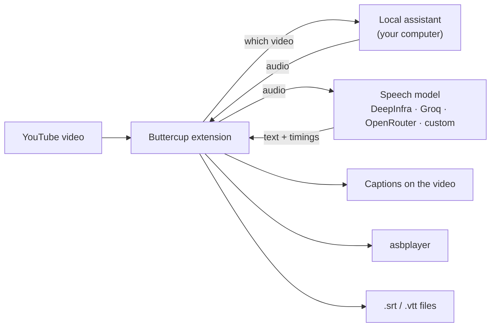

<div align="center">


# Buttercup Revival

**On-demand YouTube transcription for Chromium and Gecko browsers.**

Buttercup Revival is an extension for Chromium-based browsers and Gecko browsers such as Firefox and Zen.
It transcribes the audio of the video you are watching with a speech model of your choice
and shows the result as captions, sends it to [asbplayer](https://github.com/asbplayer/asbplayer),
or saves it as an `.srt` file.

[](https://github.com/arrow-poppa/buttercup-revival/actions/workflows/test.yml)
[](https://github.com/arrow-poppa/buttercup-revival/releases/latest)


[Install](#-installation) · [Firefox / Zen guide](docs/GECKO_SETUP.md) · [First subtitles](#-your-first-subtitles) · [asbplayer](#-using-it-with-asbplayer) · [Settings](#-settings) · [Troubleshooting](#-troubleshooting) · [Developers](#-for-developers)


</div>

---

## ✨ What it does

- **Subtitles for videos that have none**, or whose automatic captions are poor.
- **Follows the speaker.** Each subtitle ends with the sentence, at a comma, or at a breath, so text appears and leaves with the speech instead of in fixed blocks.
- **You choose the speech model.** DeepInfra, Groq, OpenRouter, or any OpenAI-compatible API. Whisper, Qwen ASR, Voxtral and others.
- **Three ways to use the result:** captions on the YouTube player, automatic delivery to **asbplayer**, or `.srt` / `.vtt` files saved to a folder you pick.
- **Reuse cached transcripts.** Change subtitle layout or export again without another provider request. Regenerate explicitly requests a fresh transcription.
- **Local audio preparation.** The assistant prepares audio on your computer; the extension sends it and the required API key only to your selected transcription provider.
- **Six interface languages:** English, Português, Español, 日本語, 简体中文, 繁體中文.

## 🧩 How it works

Buttercup has two parts that the installer sets up together:

| Part | What it is | What it does |
| --- | --- | --- |
| **The extension** | Chromium or Gecko WebExtension | Adds the **BC** button to the YouTube player, talks to the speech model, shows and exports subtitles |
| **The local assistant** | A small program on your computer | Fetches the video's audio with `yt-dlp` and prepares it with FFmpeg |



The assistant only runs when you ask for it and only listens to your own computer (`127.0.0.1`).

## 📋 What you need

- **Windows 10 or 11**, or **Linux**.
- **A supported desktop browser:** Chromium 120+ (Chrome, Edge, Brave, Vivaldi, Opera, Chromium and compatible forks), or Gecko 140+ (Firefox, Zen and compatible modern forks). See [Chromium compatibility](docs/BROWSERS.md) and [Firefox / Zen setup](docs/GECKO_SETUP.md).
- **An API key** from a speech provider. Creating one takes a couple of minutes; see [step 4](#step-4--add-your-api-key).
- About **1 GB** of free disk space.

You do **not** need to install Python, Node.js or FFmpeg yourself. The installer does it.

## 🚀 Installation

Start with the route for your browser. Native installations connect through the browser's native-messaging API. Flatpak Zen can use an optional automatic launcher with Flatseal or a manual connection file.

| Browser | Build | Setup guide |
| --- | --- | --- |
| Chromium-based | `dist/chromium` | Continue with the steps below |
| Firefox / Zen / modern Gecko forks | `dist/firefox` or `dist/firefox-unsigned.zip` | [Follow the Firefox / Zen guide](docs/GECKO_SETUP.md) |
| Zen Flatpak | Gecko build | [Automatic with Flatseal](docs/GECKO_SETUP.md#method-a-automatic-connection-with-flatseal) or [manual connection](docs/GECKO_SETUP.md#method-b-manual-connection-without-extra-flatpak-permissions) |

### Step 1 · Download

1. **[Download Buttercup (ZIP)](https://github.com/arrow-poppa/buttercup-revival/releases/latest/download/Buttercup-Revival.zip)**.
2. **Extract** the ZIP: right-click it → **Extract All…**
3. Put the extracted folder somewhere it can stay, for example **Documents**.

> [!IMPORTANT]
> The extension runs from this folder. If you move or delete it later, Buttercup stops working.

> [!NOTE]
> Starting with **v0.6.0**, the release ZIP includes both browser builds: `dist/chromium`, `dist/firefox` and `dist/firefox-unsigned.zip`. For Firefox/Zen, follow the [Gecko setup guide](docs/GECKO_SETUP.md), including the signing requirements for your browser.

### Step 2 · Run the installer

<details open>
<summary><b>Windows</b></summary>

Open the folder and double-click **`Install Buttercup.cmd`**.

A window opens and shows five steps as it works. It downloads and installs whatever is missing,
so the first run can take a few minutes. When it finishes it opens the folder you will need in step 3.

- If Windows shows **"Windows protected your PC"**, click **More info** → **Run anyway**. This appears for any downloaded script.
- If a window asks for permission to install **Node.js**, choose **Yes**.

</details>

<details>
<summary><b>Linux</b></summary>

Open a terminal in the folder and run:

```sh
sh install.sh
```

It uses your package manager (`apt`, `dnf`, `pacman` or `zypper`) and asks for your password only to install missing packages.

For automatic startup, use a native browser package (`.deb` / `.rpm`). **Snap** and **Flatpak** may block native messaging. Zen Flatpak users can follow the [automatic or manual connection tutorial](docs/GECKO_SETUP.md#4-connect-the-assistant).

</details>

### Step 3 · Add the extension to your browser

**Firefox, Zen and other modern Gecko browsers:** use the [step-by-step installation guide](docs/GECKO_SETUP.md). It explains permanent unsigned installation in Zen, the differences between Firefox editions, and both Flatpak connection methods. **Helium on Linux** uses the Chromium build; its native-host paths are registered, while live Helium runtime validation remains pending.

**Unsigned Gecko builds:** Zen can keep an unsigned extension installed after `xpinstall.signatures.required` is set to `false` in `about:config`. Standard Firefox release builds still enforce signing; Firefox ESR, Developer Edition, Nightly, LibreWolf, and Waterfox have different policies. The guide includes [verified signing requirements and source links](docs/GECKO_SETUP.md#which-other-browsers-allow-this).

The steps below apply to Chromium-based browsers.

Browsers only install extensions automatically from their store, so this one step is done by hand.

1. Open your Chromium-based browser and type **`chrome://extensions`** in the address bar, then press Enter.
2. Turn on **Developer mode** (top right in Chrome, left side in Edge).
3. Click **Load unpacked**.
4. Choose the folder **`dist/chromium`** inside the Buttercup folder. On Windows the installer already copied its address: press **Ctrl + V** in the folder window, then **Select Folder**.


Buttercup now appears in the list. Click the puzzle-piece icon in the toolbar and **pin** Buttercup so its icon stays visible.

### Step 4 · Add your API key

The speech model runs at a provider, which needs a key to know the request is yours.

1. Create an account and a key at one of these:

   | Provider | Good to know | Get a key |
   | --- | --- | --- |
   | **Groq** | Has a free tier; fast | [console.groq.com/keys](https://console.groq.com/keys) |
   | **DeepInfra** | Pay as you go; many speech models (Whisper, Qwen ASR, Voxtral) | [deepinfra.com/dash/api_keys](https://deepinfra.com/dash/api_keys) |
   | **OpenRouter** | One account for many providers | [openrouter.ai/keys](https://openrouter.ai/keys) |

2. Click the **Buttercup icon** in the browser toolbar.
3. Connect the assistant using **Start and connect**, or your chosen [Flatpak method](docs/GECKO_SETUP.md#4-connect-the-assistant). The badge changes to **Connected**.
4. Under **Transcription**, choose your provider and paste the key.


Everything is saved automatically. You are done.

## 🎬 Your first subtitles

1. Open any YouTube video.
2. Click the pink **BC** button in the player controls.
3. A purple notice shows the progress: extracting audio, transcribing, done.
4. Subtitles appear on the video. Click **BC** again to hide or show them.

The first time takes roughly as long as the provider needs to transcribe the audio. Opening the same video later is instant, because the result is cached.

> [!TIP]
> After restarting the computer, open the Buttercup popup and click **Start and connect** once.

**Two messages you may meet**

- *"Human captions are available"*: the video already has captions written by a person. To replace them anyway, turn off **Prefer human captions** under **General**.
- *"Multiple audio tracks detected"*: the video is dubbed. Set **Audio track for transcription** to **Original audio**. You can leave it there for every video.

## 📚 Using it with asbplayer

Buttercup can hand its subtitles straight to [asbplayer](https://github.com/asbplayer/asbplayer) for language study.

The two talk through asbplayer's **WebSocket server**, a small program from the asbplayer project that runs on your computer. It is not part of Buttercup and the installer does not set it up, so do this once:

**1 · Start asbplayer's WebSocket server**

Install [Go](https://go.dev/dl/) and [Git](https://git-scm.com/downloads), then run in a terminal:

```sh
git clone https://github.com/asbplayer/asbplayer.git
cd asbplayer/scripts/web-socket-server
go run .
```

Leave that window open while you use asbplayer. Next time, only the last two lines are needed. asbplayer's own [WebSocket server guide](https://docs.asbplayer.dev/docs/guides/web-socket-server) has the details and options.

**2 · Let asbplayer connect to it**

Open asbplayer's settings, go to **Misc**, and enable the **WebSocket client**. Leave the address as it is.

**3 · Tell Buttercup to use it**

In the Buttercup popup, open **Integrations · asbplayer**:

- Click **Check connected media** to confirm Buttercup can reach the server.
- Turn on **Auto-send subtitles to asbplayer**.
- To see only asbplayer's subtitles, turn off **Show Buttercup captions on the YouTube video** under **General**.

From then on, pressing **BC** generates the subtitles and loads them into asbplayer. The **Send to asbplayer** button sends them again at any time, including from the cache.

## 💾 Saving subtitle files

- **Download SRT** / **Download VTT** save the current video's subtitles.
- **Save SRT automatically after generating** does it for every video.
- **Folder for subtitle files** chooses where they go. Leave it blank to use the browser's Downloads folder, or type a full path such as `D:\Subtitles`. The folder must already exist.

Files are named `[videoID]___Title.srt`, for example `[dQw4w9WgXcQ]___Never Gonna Give You Up.srt`. A newer file replaces an older one with the same name.

## 🔧 Settings

The popup is organised in sections. The ones you are most likely to touch:

| Section | Setting | What it does |
| --- | --- | --- |
| **Header** | Language | Interface language. *Auto* follows the browser |
| **General** | Audio track for transcription | *Original audio* avoids transcribing a dub |
| | Show Buttercup captions on the YouTube video | Off = subtitles only go to asbplayer or to files |
| | Spoken language | Leave blank to detect it; set it (`ja`, `en`, `pt`…) if detection gets it wrong |
| | Folder for subtitle files | Where `.srt` / `.vtt` files are written |
| **Transcription** | Provider, key and model | Which speech model transcribes the audio |
| | Request word timestamps | Needed for short, speech-aligned subtitles. Keep it on |
| | Vocabulary prompt | Names and unusual words, to help the model spell them |
| **Subtitle layout** | Start a new subtitle | Follow the speaker, or cut only at the word limit |
| | Max words per subtitle | The cap on how much text is on screen at once |
| | Line break every N words | Wraps a subtitle into lines |
| **Audio upload (advanced)** | Audio sending | *In parts* works with any length; *Whole audio* is a single request |
| | Audio format | MP3 (default) or FLAC, remembered for each provider/model configuration |
| **Keyboard shortcuts** | Configure shortcuts | Customize Generate and Regenerate in the browser's shortcut settings |
| **Backup** | Export / Import settings | Save your settings to a file and load them later |

Keyboard shortcuts work on the active YouTube video with the popup closed. Defaults: **Alt+Shift+G** generates using the cache when available; **Alt+Shift+U** regenerates with a fresh provider request (charges may apply). Open **Keyboard shortcuts → Configure shortcuts** in Buttercup to remap or disable them. Chromium opens its extension shortcut page; Firefox/Zen opens Manage Extension Shortcuts. The browser stores assignments separately from settings backups, and reserved or conflicting combinations may remain unassigned or be intercepted by the browser. Physical key events were tested under Xvfb in Chromium and Firefox, including custom Firefox assignments; run the browser suites with `BUTTERCUP_TEST_SHORTCUTS=1` on an isolated X11 display to reproduce.

In Buttercup segmentation modes, subtitle word limits also apply when a provider returns only segment timestamps or puts a whole phrase in one word entry. In those cases, internal cue boundaries are estimated within the original segment and the completion message explains this; real word timestamps are preserved. Japanese/Chinese use text characters while keeping Latin words and Unicode graphemes intact. Choose **Start a new subtitle → Keep provider segments (original timing)** to use the returned segment boundaries instead. This bypasses the word cap; set **Line break** to **0** to preserve the returned text layout. When no segments were returned, the original timestamped word entries are used. Changing layout reformats cached subtitles without calling a provider. **Regenerate subtitles** explicitly bypasses local and community caches and requests a fresh transcription (provider charges may apply); a failed request preserves the last cached result.


Changing **Subtitle layout** never costs anything: it rearranges the words that were already transcribed.

<details>
<summary><b>About upload size and long videos</b></summary>

Providers limit the size of one uploaded file. Keep **Max audio chunk (MB)** within your provider's allowance; Buttercup defaults to 24 MB. MP3 at 64 kbps uses about 0.48 MB per minute. FLAC size depends on the audio, so the same upload limit can fit a different duration.

For anything longer, keep **Audio sending** on **In parts**: the audio is cut into pieces that overlap by 1.5 seconds, each piece is transcribed separately, and the results are joined without repeating or losing words.

</details>

**Audio format** offers **MP3 — smaller uploads (default)** and **FLAC — lossless encoding, usually larger uploads**. Both use **16 kHz mono** audio; MP3 uses **64 kbps**, and FLAC uses **16-bit samples**. Each format is encoded directly from the downloaded source. FLAC avoids an additional lossy encoding step, but cannot recover detail already lost in YouTube's audio and does not guarantee better transcription or timestamps.

Buttercup remembers the format separately for each provider, API endpoint/mode, model and pinned upstream provider, including in settings backups. Existing installations and older backups default to MP3. Both options remain selectable for every provider. Format acceptance depends on the selected API/model; rejected uploads are not retried with another format or provider. FLAC requires the updated local assistant: run the installer and restart the assistant after updating.

Changing the format **reuses cached subtitles**. Choose **Regenerate subtitles** to send freshly encoded audio in the selected format; provider charges may apply. The short sample test uploads the file you select unchanged, so use a sample already encoded in the format you want to test. No accuracy improvement or paid-provider benchmark is claimed.

<details>
<summary><b>About cookies and restricted videos</b></summary>

Age-restricted or members-only videos need you to be signed in. Under **YouTube Authentication / Cookies** you can import a `cookies.txt` file exported from your browser. Only YouTube and Google cookies are accepted, and they stay on your computer.

</details>

For Japanese, Chinese, and other supported scripts without spaces, subtitle layout uses character counts instead of space-separated words. Timed tokens join without artificial spaces; Latin words and numbers stay intact in mixed text. Line wrapping preserves Unicode graphemes and keeps closing punctuation with the preceding text. Subtitle boundaries still follow provider timestamps: a long phrase returned as one timed entry can wrap onto multiple lines, but is not assigned invented per-character times.

## 🌍 Languages

The interface is available in **English, Português (Brasil), Español, 日本語, 简体中文 and 繁體中文**. Pick one from the menu at the top of the popup. With automatic language selection, Traditional Chinese is used for Taiwan, Hong Kong, Macao and `zh-Hant` browser locales; an explicit script preference takes priority over the region.

Translations live in [`locales/`](locales), one file per language, as `"original text": "translation"`. All source strings and translation keys are English. The extension description and installers are always English. Text without a translation is shown as written, so a missing entry never breaks anything. To add a language, copy a file, translate the values, and register it in [`api/i18n.js`](api/i18n.js).

## 🔄 Updating

1. Download the [latest ZIP](https://github.com/arrow-poppa/buttercup-revival/releases/latest/download/Buttercup-Revival.zip) and extract it **over the same folder**, replacing the files.
2. Run the installer again.
3. Open `chrome://extensions` and click the **reload** arrow on the Buttercup card.

Your settings stay where they are. To be safe, use **Backup → Export settings** first. To restore a backup, choose **Backup → Import settings**. Buttercup opens a settings tab; select your JSON file there and click **Import settings**. Keep the tab open until the import completes.

All file selections use this persistent page: **Test transcription and timestamps**, **Import cookies**, **Open connection editor**, and **Import settings** open the relevant section in a tab. Choose the file there, then click the test/import button. Closing the original popup or switching tabs keeps the selected file available. Opening the page or selecting a file does not send it; audio tests and cookie imports require your explicit submission. Cookie persistence remains off unless you enable it for that import.

## 🧹 Uninstalling

1. **Windows:** double-click **`Uninstall Buttercup.cmd`**. **Linux:** run `.venv/bin/python scripts/setup-assistant.py --uninstall`.
2. Remove **Buttercup Revival** in `chrome://extensions`.
3. Delete the Buttercup folder.

Python, Node.js and FFmpeg stay installed, since other programs may use them. Remove them from your system's app list if you want to.

## 🛠 Troubleshooting

| What you see | What to do |
| --- | --- |
| The assistant badge says **Disconnected** | Native browsers and the Flatseal bridge use **Start and connect**. Manual Flatpak connections use **Start Buttercup assistant.sh**, then **Check connection** |
| The browser cannot reach the local assistant | Run the installer from the correct extracted folder. For Flatpak, complete [Method A or B](docs/GECKO_SETUP.md#4-connect-the-assistant); installing the add-on alone is not enough |
| No **BC** button on the player | Reload the YouTube page. Check that **Enable Buttercup** is on |
| A **Reload extension** button appears in the popup | Click it. The extension was updated while it was open |
| *"Set your … API key first"* | Paste the key of the provider selected under **Transcription** |
| *"YouTube rejected extraction (403)"* or *authentication failed* | Import fresh cookies, or try again later; YouTube sometimes blocks downloads temporarily |
| Subtitles are huge blocks of text | Select a Buttercup segmentation mode and lower **Max words per subtitle**. Original provider segmentation bypasses that limit. If word timings are unavailable, internal cue times are estimated |
| *"asbplayer is unavailable"* | Start asbplayer's WebSocket server and enable the WebSocket client in asbplayer; see [Using it with asbplayer](#-using-it-with-asbplayer) |
| The upload is refused as too large | Use **Audio sending → In parts** |
| The installer says a program could not be installed | Install it by hand ([Python](https://www.python.org/downloads/), [Node.js](https://nodejs.org/), [FFmpeg](https://ffmpeg.org/download.html)) and run the installer again |
| Nothing happens and there is no message | Open the popup: the status line at the top shows the last error |

Still stuck? [Open an issue](https://github.com/arrow-poppa/buttercup-revival/issues) with the message you see and the steps that led to it.

## 🔒 Privacy and security

- **Audio** is downloaded and converted on your computer, then sent only to the provider you selected.
- **API keys** are stored in the extension's private storage and are sent only to that provider. The YouTube page never sees them.
- **The local assistant** accepts connections only from your computer and only from this extension, using a random token created at installation.
- **Per-user assistant setup.** The assistant lives in the Buttercup folder and registers per user. The installer may use your system package manager for missing dependencies; the assistant has no automatic login startup.
- **No telemetry.** The optional community cache is off by default and, when enabled, shares subtitle text and video/model details only.

A settings backup contains your API keys. Treat that file like a password.

## 👩‍💻 For developers

<details>
<summary><b>Project layout</b></summary>

```
manifest.json, popup.html      Extension manifest and popup
buttercup.js, content.js       Player button, captions and progress notice (content scripts)
background/, gecko/            Shared processing and Chromium/Gecko compatibility
api/                           Settings, providers, transcription pipeline, i18n
subtitles/, cache/             Cue formatting, SRT/VTT export, IndexedDB cache
integrations/                  asbplayer
locales/                      Interface translations (English source keys)
backend/                       Local assistant (FastAPI, yt-dlp, pytubefix, FFmpeg)
scripts/                       Installers, native-messaging bridge, build and browser tests
tests/                         Node and pytest unit tests
docs/                          Technical notes, upstream analysis, validation log
```

</details>

<details>
<summary><b>Building and testing</b></summary>

Requires Python 3.11+, Node.js 22+ and FFmpeg. Each installer run asks pip to upgrade yt-dlp and pytubefix to the latest stable versions compatible with the installed Python and dependency requirements.

```sh
python -m venv .venv
.venv/bin/python -m pip install -r backend/requirements-dev.txt   # Windows: .venv\Scripts\python.exe
npm ci

npm run build                       # generates dist/chromium, dist/firefox and dist/firefox-unsigned.zip
npm run package                     # builds the release archive, dist/Buttercup-Revival.zip
npm test                            # JavaScript unit tests
.venv/bin/python -m pytest tests/backend -q
```

The extension has no bundler: `npm run build` copies shared files and applies the small Gecko manifest/API/storage adaptations. `node scripts/build.mjs` is all the installer needs. See [Gecko architecture and runtime validation](docs/firefox.md).

</details>

<details>
<summary><b>Design notes</b></summary>

- **Chromium Manifest V3; Gecko Manifest V2 with a hidden persistent background page.** No remote code. Captions use the video's native `TextTrack`.
- **Stable extension identities.** Chromium derives its ID from the manifest public key; Gecko uses an explicit add-on ID. The installer registers both automatically.
- **Native messaging bridge** with a single allow-listed action: start the local service and return its pairing token.
- **Provider requests are never retried or re-routed** after a failure, so a paid request is not silently repeated.
- More detail (in Portuguese): [technical notes](docs/TECHNICAL.pt-BR.md), [changes from upstream](docs/CHANGES.md), [validation log](docs/VALIDATION.md).

</details>

Contributions are welcome. Please run the unit tests before opening a pull request.

## 🙏 Credits

Buttercup Revival is a modernised fork of **[Buttercup](https://github.com/iGerman00/buttercup-chrome) by iGerman00**, which created the idea, the name and the look. If you find it useful, consider [supporting the original author](https://github.com/iGerman00).

Built on [yt-dlp](https://github.com/yt-dlp/yt-dlp), [pytubefix](https://github.com/JuanBindez/pytubefix), [FFmpeg](https://ffmpeg.org/) and [FastAPI](https://fastapi.tiangolo.com/).

The original project does not declare a license, and this fork does not add one; see [docs/UPSTREAM.md](docs/UPSTREAM.md).
