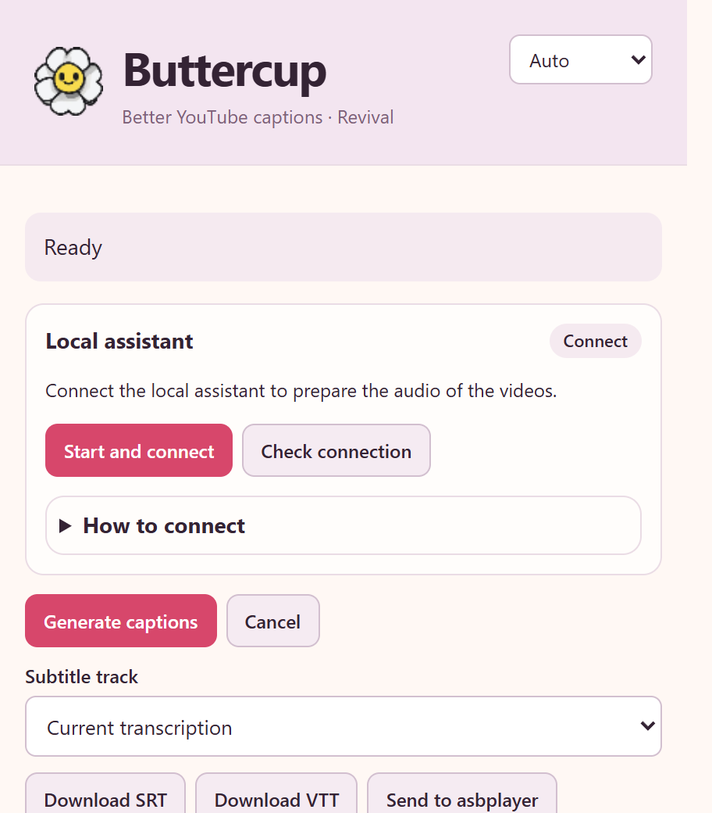
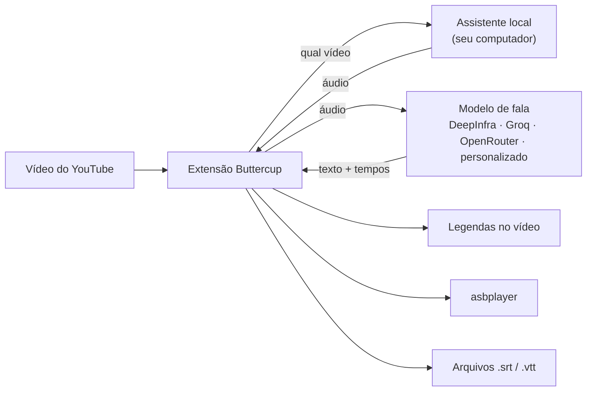
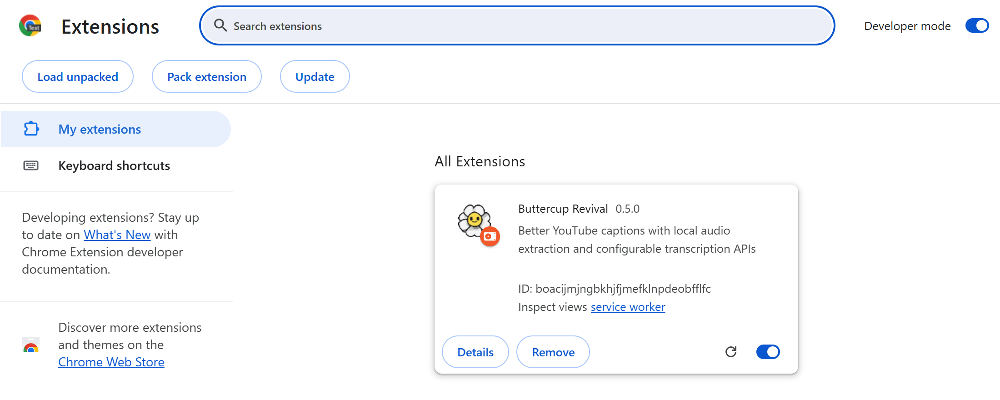
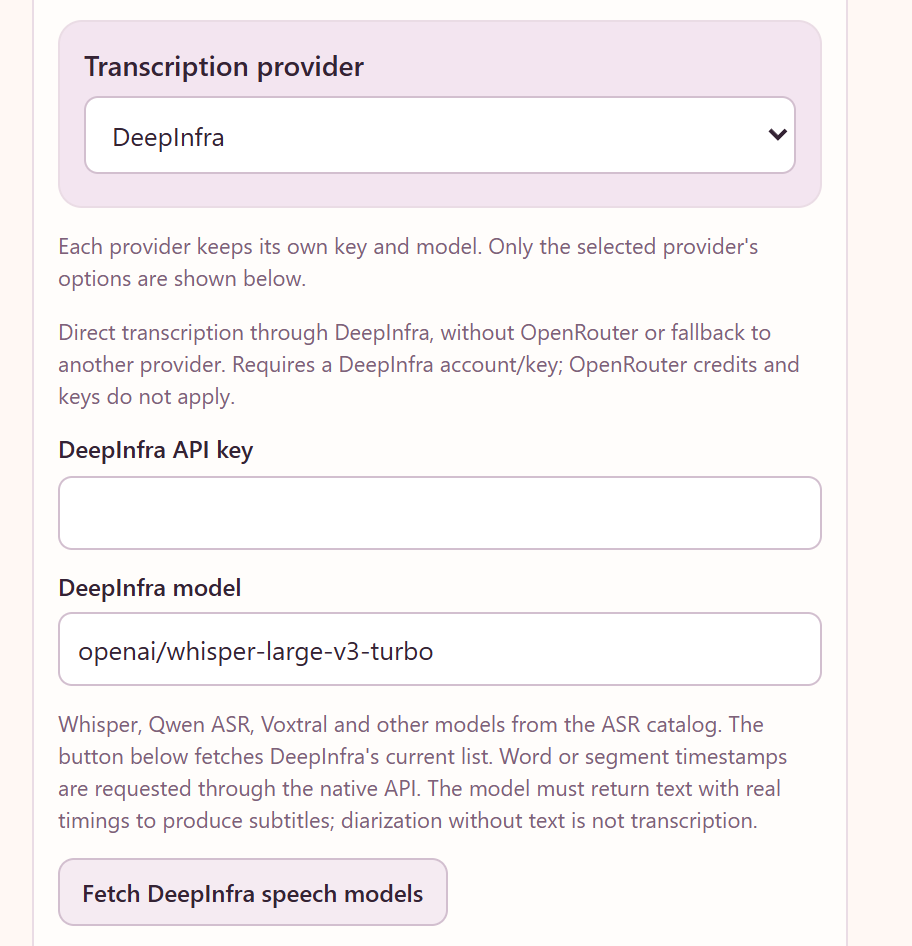
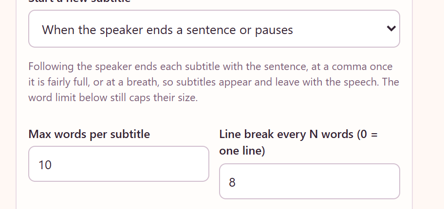

<div align="center">


# Buttercup Revival

**Transcrição de vídeos do YouTube sob demanda para navegadores Chromium e Gecko.**

O Buttercup Revival é uma extensão para navegadores baseados em Chromium e navegadores Gecko, como Firefox e Zen.
Ela transcreve o áudio do vídeo que você está assistindo com o modelo de fala de sua escolha
e exibe o resultado como legendas, envia-o ao [asbplayer](https://github.com/asbplayer/asbplayer)
ou salva um arquivo `.srt`.

[](https://github.com/arrow-poppa/buttercup-revival/actions/workflows/test.yml)
[](https://github.com/arrow-poppa/buttercup-revival/releases/latest)


[English](README.md) · **Português (Brasil)** · [Español](README.es.md) · [日本語](README.ja.md) · [简体中文](README.zh-CN.md) · [繁體中文](README.zh-TW.md)

[Instalação](#-instalação) · [Guia Firefox / Zen](docs/pt-BR/GECKO_SETUP.md) · [Primeiras legendas](#-suas-primeiras-legendas) · [asbplayer](#-usando-com-o-asbplayer) · [Configurações](#-configurações) · [Solução de problemas](#-solução-de-problemas) · [Desenvolvedores](#-para-desenvolvedores)



</div>

---

## ✨ O que ele faz

- **Legendas para vídeos que não têm legendas** ou cujas legendas automáticas são ruins.
- **Acompanha a fala.** Cada legenda termina com a frase, em uma vírgula ou em uma pausa, para que o texto apareça e desapareça junto com a fala em vez de blocos fixos.
- **Você escolhe o modelo de fala.** DeepInfra, Groq, OpenRouter ou qualquer API compatível com OpenAI. Whisper, Qwen ASR, Voxtral e outros.
- **Três formas de usar o resultado:** legendas no player do YouTube, envio automático ao **asbplayer** ou arquivos `.srt` / `.vtt` salvos em uma pasta escolhida por você.
- **Reutilize transcrições em cache.** Altere o layout das legendas ou exporte novamente sem outra solicitação ao provedor. Regenerar solicita explicitamente uma nova transcrição.
- **Preparação local do áudio.** O assistente prepara o áudio no seu computador; a extensão envia o áudio e a chave de API necessária somente ao provedor de transcrição escolhido.
- **Seis idiomas de interface:** English, Português, Español, 日本語, 简体中文, 繁體中文.

## 🧩 Como funciona

O Buttercup tem duas partes que o instalador configura em conjunto:

| Parte | O que é | O que faz |
| --- | --- | --- |
| **A extensão** | WebExtension para Chromium ou Gecko | Adiciona o botão **BC** ao player do YouTube, comunica-se com o modelo de fala e exibe e exporta legendas |
| **O assistente local** | Um pequeno programa no computador | Obtém o áudio do vídeo com `yt-dlp` e o prepara com FFmpeg |



O assistente só é executado quando você solicita e só aceita conexões do próprio computador (`127.0.0.1`).

## 📋 O que você precisa

- **Windows 10 ou 11** ou **Linux**.
- **Um navegador de desktop compatível:** Chromium 120+ (Chrome, Edge, Brave, Vivaldi, Opera, Chromium e forks compatíveis) ou Gecko 140+ (Firefox, Zen e forks modernos compatíveis). Consulte a [compatibilidade Chromium](docs/pt-BR/BROWSERS.md) e a [configuração Firefox / Zen](docs/pt-BR/GECKO_SETUP.md).
- **Uma chave de API** de um provedor de fala. Criar uma leva alguns minutos; veja a [etapa 4](#etapa-4--adicione-sua-chave-de-api).
- Aproximadamente **1 GB** de espaço livre.

Você **não** precisa instalar Python, Node.js ou FFmpeg por conta própria. O instalador faz isso.

## 🚀 Instalação

Comece pela opção correspondente ao seu navegador. Instalações nativas conectam-se pela API de mensagens nativas do navegador. O Zen Flatpak pode usar um inicializador automático opcional com Flatseal ou um arquivo de conexão manual.

| Navegador | Versão | Guia de configuração |
| --- | --- | --- |
| Baseado em Chromium | `dist/chromium` | Continue com as etapas abaixo |
| Firefox / Zen / forks Gecko modernos | `dist/firefox` ou `dist/firefox-unsigned.zip` | [Siga o guia Firefox / Zen](docs/pt-BR/GECKO_SETUP.md) |
| Zen Flatpak | Versão Gecko | [Automática com Flatseal](docs/pt-BR/GECKO_SETUP.md#flatseal) ou [conexão manual](docs/pt-BR/GECKO_SETUP.md#manual) |

### Etapa 1 · Baixe

1. **[Baixe o Buttercup (ZIP)](https://github.com/arrow-poppa/buttercup-revival/releases/latest/download/Buttercup-Revival.zip)**.
2. **Extraia** o ZIP: clique com o botão direito → **Extrair tudo…**
3. Coloque a pasta extraída em um lugar permanente, por exemplo, **Documentos**.

> [!IMPORTANT]
> A extensão é executada a partir dessa pasta. Se você movê-la ou apagá-la depois, o Buttercup deixará de funcionar.

> [!NOTE]
> A partir da **v0.6.0**, o ZIP da versão inclui as duas compilações: `dist/chromium`, `dist/firefox` e `dist/firefox-unsigned.zip`. Para Firefox/Zen, siga o [guia Gecko](docs/pt-BR/GECKO_SETUP.md), incluindo os requisitos de assinatura do navegador.

### Etapa 2 · Execute o instalador

<details open>
<summary><b>Windows</b></summary>

Abra a pasta e clique duas vezes em **`Install Buttercup.cmd`**.

Uma janela se abre e mostra cinco etapas durante o processo. Ela baixa e instala o que estiver faltando, então a primeira execução pode levar alguns minutos. Ao terminar, abre a pasta necessária na etapa 3.

- Se o Windows mostrar **"O Windows protegeu o computador"**, clique em **Mais informações** → **Executar assim mesmo**. Isso pode aparecer para scripts baixados.
- Se uma janela pedir permissão para instalar o **Node.js**, escolha **Sim**.

</details>

<details>
<summary><b>Linux</b></summary>

Abra um terminal na pasta e execute:

```sh
sh install.sh
```

O instalador usa o gerenciador de pacotes (`apt`, `dnf`, `pacman` ou `zypper`) e solicita sua senha apenas para instalar pacotes ausentes.

Para inicialização automática, use um pacote nativo do navegador (`.deb` / `.rpm`). **Snap** e **Flatpak** podem bloquear mensagens nativas. Usuários do Zen Flatpak podem seguir o [tutorial de conexão automática ou manual](docs/pt-BR/GECKO_SETUP.md#connect).

</details>

### Etapa 3 · Adicione a extensão ao navegador

**Firefox, Zen e outros navegadores Gecko modernos:** use o [guia de instalação passo a passo](docs/pt-BR/GECKO_SETUP.md). Ele explica a instalação permanente não assinada no Zen, as diferenças entre edições do Firefox e os dois métodos de conexão Flatpak. **Helium no Linux** usa a versão Chromium; os caminhos do assistente nativo são registrados, mas a validação em execução no Helium ainda está pendente.

**Versões Gecko não assinadas:** o Zen pode manter uma extensão não assinada após definir `xpinstall.signatures.required` como `false` em `about:config`. O Firefox Release padrão continua exigindo assinatura; Firefox ESR, Developer Edition, Nightly, LibreWolf e Waterfox têm políticas diferentes. O guia inclui [requisitos de assinatura verificados e links para as fontes](docs/pt-BR/GECKO_SETUP.md#quais-outros-navegadores-permitem-isso).

As etapas abaixo se aplicam a navegadores baseados em Chromium.

Os navegadores só instalam extensões automaticamente a partir de suas lojas, portanto esta etapa é manual.

1. Abra seu navegador baseado em Chromium, digite **`chrome://extensions`** na barra de endereço e pressione Enter.
2. Ative o **Modo do desenvolvedor** (canto superior direito no Chrome, lado esquerdo no Edge).
3. Clique em **Carregar sem compactação**.
4. Escolha a pasta **`dist/chromium`** dentro da pasta Buttercup. No Windows, o instalador já copiou o endereço: pressione **Ctrl + V** na janela de escolha de pasta e clique em **Selecionar pasta**.



O Buttercup agora aparece na lista. Clique no ícone de peça de quebra-cabeça na barra de ferramentas e **fixe** o Buttercup para manter o ícone visível.

### Etapa 4 · Adicione sua chave de API

O modelo de fala é executado em um provedor, que precisa de uma chave para identificar sua solicitação.

1. Crie uma conta e uma chave em um dos seguintes:

   | Provedor | Informações | Obter uma chave |
   | --- | --- | --- |
   | **Groq** | Tem plano gratuito; rápido | [console.groq.com/keys](https://console.groq.com/keys) |
   | **DeepInfra** | Pagamento por uso; muitos modelos de fala (Whisper, Qwen ASR, Voxtral) | [deepinfra.com/dash/api_keys](https://deepinfra.com/dash/api_keys) |
   | **OpenRouter** | Uma conta para vários provedores | [openrouter.ai/keys](https://openrouter.ai/keys) |

2. Clique no **ícone do Buttercup** na barra de ferramentas do navegador.
3. Conecte o assistente usando **Iniciar e conectar** ou o [método Flatpak](docs/pt-BR/GECKO_SETUP.md#connect) escolhido. O indicador muda para **Conectado**.
4. Em **Transcrição**, escolha o provedor e cole a chave.



Tudo é salvo automaticamente. Pronto.

## 🎬 Suas primeiras legendas

1. Abra qualquer vídeo no YouTube.
2. Clique no botão rosa **BC** nos controles do player.
3. Um aviso roxo mostra o progresso: extração de áudio, transcrição e conclusão.
4. As legendas aparecem no vídeo. Clique em **BC** novamente para ocultá-las ou mostrá-las.

A primeira vez leva aproximadamente o tempo que o provedor precisa para transcrever o áudio. Ao abrir o mesmo vídeo depois, o resultado é imediato porque fica em cache.

> [!TIP]
> Após reiniciar o computador, abra o popup do Buttercup e clique uma vez em **Iniciar e conectar**.

**Duas mensagens que você pode encontrar**

- *"Human captions are available"*: o vídeo já tem legendas feitas por uma pessoa. Para substituí-las mesmo assim, desative **Preferir legendas humanas** em **Geral**.
- *"Multiple audio tracks detected"*: o vídeo é dublado. Defina **Faixa de áudio para transcrição** como **Áudio original**. Você pode deixar essa opção ativa para todos os vídeos.

## 📚 Usando com o asbplayer

O Buttercup pode enviar suas legendas diretamente ao [asbplayer](https://github.com/asbplayer/asbplayer) para estudo de idiomas.

Os dois se comunicam pelo **servidor WebSocket** do asbplayer, um pequeno programa do projeto asbplayer executado no seu computador. Ele não faz parte do Buttercup e não é configurado pelo instalador, então faça isto uma vez:

**1 · Inicie o servidor WebSocket do asbplayer**

Instale [Go](https://go.dev/dl/) e [Git](https://git-scm.com/downloads), depois execute em um terminal:

```sh
git clone https://github.com/asbplayer/asbplayer.git
cd asbplayer/scripts/web-socket-server
go run .
```

Deixe essa janela aberta enquanto usa o asbplayer. Na próxima vez, apenas as duas últimas linhas serão necessárias. O [guia do servidor WebSocket](https://docs.asbplayer.dev/docs/guides/web-socket-server) do asbplayer contém os detalhes e opções.

**2 · Permita que o asbplayer se conecte**

Abra as configurações do asbplayer, acesse **Misc** e ative **WebSocket client**. Deixe o endereço como está.

**3 · Configure o Buttercup para usá-lo**

No popup do Buttercup, abra **Integrações · asbplayer**:

- Clique em **Verificar mídias conectadas** para confirmar que o Buttercup alcança o servidor.
- Ative **Enviar legendas automaticamente ao asbplayer**.
- Para ver somente as legendas do asbplayer, desative **Mostrar as legendas do Buttercup no vídeo do YouTube** em **Geral**.

Depois disso, pressionar **BC** gera as legendas e as carrega no asbplayer. O botão **Enviar ao asbplayer** as envia novamente a qualquer momento, inclusive do cache.

## 💾 Salvando arquivos de legenda

- **Baixar SRT** / **Baixar VTT** salvam as legendas do vídeo atual.
- **Salvar o SRT automaticamente depois de gerar** faz isso para cada vídeo.
- **Pasta para os arquivos de legenda (em branco = Downloads do navegador)** escolhe onde salvá-las. Deixe vazio para usar a pasta Downloads do navegador ou digite um caminho completo, como `D:\Subtitles`. A pasta já deve existir.

Os arquivos são nomeados `[videoID]___Title.srt`, por exemplo `[dQw4w9WgXcQ]___Never Gonna Give You Up.srt`. Um arquivo mais novo substitui outro com o mesmo nome.

## 🔧 Configurações

O popup é organizado em seções. As opções que você provavelmente usará mais:

| Seção | Configuração | O que faz |
| --- | --- | --- |
| **Cabeçalho** | Idioma | Idioma da interface. *Automático* segue o navegador |
| **Geral** | Faixa de áudio para transcrição | *Áudio original* evita transcrever uma dublagem |
| | Mostrar as legendas do Buttercup no vídeo do YouTube | Desativado = legendas apenas no asbplayer ou em arquivos |
| | Idioma falado (em branco = automático) | Deixe vazio para detectar; defina (`ja`, `en`, `pt`…) se a detecção falhar |
| | Pasta para os arquivos de legenda (em branco = Downloads do navegador) | Onde os arquivos `.srt` / `.vtt` são salvos |
| **Transcrição** | Provedor, chave e modelo | Qual modelo de fala transcreve o áudio |
| | Solicitar timestamps de palavras | Necessário para legendas curtas alinhadas à fala. Mantenha ativado |
| | Prompt de vocabulário | Nomes e palavras incomuns para ajudar o modelo a escrevê-los |
| **Formato das legendas** | Iniciar uma nova legenda | Acompanha a fala ou corta apenas no limite de palavras |
| | Máximo de palavras por legenda | Limite de texto exibido de uma vez |
| | Quebra de linha a cada N palavras (0 = uma linha) | Divide uma legenda em linhas |
| **Envio do áudio (avançado)** | Envio do áudio | *Em partes (compatível com vídeos longos)* funciona com qualquer duração; *Áudio inteiro (um único pedido)* usa uma única solicitação |
| | Formato de áudio | MP3 (padrão) ou FLAC, lembrado para cada configuração de provedor/modelo |
| **Atalhos de teclado** | Configurar atalhos | Personaliza Gerar e Regenerar nas configurações de atalhos do navegador |
| **Cópia de segurança** | Export / Import settings | Salva as configurações em um arquivo e as carrega depois |

Os atalhos funcionam no vídeo ativo do YouTube com o popup fechado. Padrões: **Alt+Shift+G** gera usando o cache quando disponível; **Alt+Shift+U** regenera com uma nova solicitação ao provedor (pode haver cobranças). Abra **Atalhos de teclado → Configurar atalhos** no Buttercup para alterá-los ou desativá-los. O Chromium abre sua página de atalhos de extensões; Firefox/Zen abre o gerenciamento de atalhos. O navegador salva as atribuições separadamente dos backups, e combinações reservadas ou conflitantes podem permanecer sem atribuição ou ser interceptadas. Eventos físicos de teclas foram testados sob Xvfb no Chromium e Firefox, incluindo atribuições personalizadas no Firefox; execute as suítes de navegador com `BUTTERCUP_TEST_SHORTCUTS=1` em um display X11 isolado para reproduzir.

Nos modos de segmentação do Buttercup, os limites de palavras também se aplicam quando o provedor retorna apenas tempos de segmentos ou coloca uma frase inteira em uma entrada de palavra. Nesses casos, os limites internos das legendas são estimados dentro do segmento original e a mensagem de conclusão explica isso; tempos reais por palavra são preservados. Japonês/chinês usam caracteres de texto mantendo palavras latinas e grafemas Unicode intactos. Escolha **Iniciar uma nova legenda → Manter segmentos do provedor (tempos originais)** para usar os limites de segmentos retornados. Isso ignora o limite de palavras; defina **Quebra de linha a cada N palavras (0 = uma linha)** como **0** para preservar o layout retornado. Quando não há segmentos, são usadas as entradas originais de palavras com tempo. Alterar o layout reformata legendas em cache sem chamar um provedor. **Regenerar legendas** ignora explicitamente os caches local e comunitário e solicita uma nova transcrição (o provedor pode cobrar); uma solicitação malsucedida preserva o último resultado em cache.



Alterar **Formato das legendas** nunca tem custo: apenas reorganiza as palavras já transcritas.

<details>
<summary><b>Sobre o tamanho do envio e vídeos longos</b></summary>

Os provedores limitam o tamanho de cada arquivo enviado. Mantenha **Tamanho máximo de um envio (MB)** dentro do limite do provedor; o padrão do Buttercup é 24 MB. MP3 a 64 kbps usa cerca de 0,48 MB por minuto. O tamanho do FLAC depende do áudio, então o mesmo limite pode comportar durações diferentes.

Para vídeos mais longos, mantenha **Envio do áudio** em **Em partes (compatível com vídeos longos)**: o áudio é dividido em partes com sobreposição de 1,5 segundo, cada parte é transcrita separadamente e os resultados são unidos sem repetir ou perder palavras.

</details>

**Formato de áudio** oferece **MP3 — menor tamanho de envio (padrão)** e **FLAC — codificação sem perdas, geralmente maior**. Ambos usam áudio **mono de 16 kHz**; MP3 usa **64 kbps**, e FLAC usa **amostras de 16 bits**. Cada formato é codificado diretamente a partir da fonte baixada. FLAC evita uma etapa adicional de codificação com perdas, mas não recupera detalhes já perdidos no áudio do YouTube nem garante melhor transcrição ou tempos.

O Buttercup lembra o formato separadamente para cada provedor, endpoint/modo de API, modelo e provedor upstream fixado, inclusive nos backups. Instalações existentes e backups antigos usam MP3 por padrão. Ambas as opções continuam selecionáveis para todos os provedores. A aceitação depende da API/modelo; envios rejeitados não são repetidos com outro formato ou provedor. FLAC exige o assistente local atualizado: execute o instalador e reinicie o assistente após atualizar.

Alterar o formato **reutiliza as legendas em cache**. Escolha **Regenerar legendas** para enviar áudio recém-codificado no formato selecionado; o provedor pode cobrar. O teste de amostra curta envia o arquivo escolhido sem alterá-lo, então use uma amostra já codificada no formato que deseja testar. Não se afirma melhoria de precisão nem foi feito benchmark pago com provedores.

<details>
<summary><b>Sobre cookies e vídeos restritos</b></summary>

Vídeos com restrição de idade ou exclusivos para membros exigem que você esteja conectado. Em **Autenticação do YouTube / Cookies**, importe um arquivo `cookies.txt` exportado do navegador. Apenas cookies do YouTube e Google são aceitos e permanecem no computador.

</details>

Para japonês, chinês e outros sistemas de escrita compatíveis sem espaços, o layout usa contagem de caracteres em vez de palavras separadas por espaços. Tokens com tempo são unidos sem espaços artificiais; palavras latinas e números permanecem intactos em texto misto. As quebras preservam grafemas Unicode e mantêm sinais de fechamento junto ao texto anterior. Os limites das legendas ainda seguem os tempos do provedor: uma frase longa retornada como uma única entrada pode ocupar várias linhas, mas não recebe tempos por caractere inventados.

## 🌍 Idiomas

A interface está disponível em **English, Português (Brasil), Español, 日本語, 简体中文 e 繁體中文**. Escolha um no menu no topo do popup. Na seleção automática, chinês tradicional é usado para localidades de Taiwan, Hong Kong, Macau e `zh-Hant`; uma preferência explícita de escrita tem prioridade sobre a região.

As traduções ficam em [`locales/`](locales), um arquivo por idioma, como `"original text": "tradução"`. Todos os textos de origem e chaves de tradução são em inglês. A descrição da extensão e os instaladores são sempre em inglês. Textos sem tradução aparecem como foram escritos, portanto uma entrada ausente não impede o funcionamento. Para adicionar um idioma, copie um arquivo, traduza os valores e registre-o em [`api/i18n.js`](api/i18n.js).

## 🔄 Atualização

1. Baixe o [ZIP mais recente](https://github.com/arrow-poppa/buttercup-revival/releases/latest/download/Buttercup-Revival.zip) e extraia-o **sobre a mesma pasta**, substituindo os arquivos.
2. Execute o instalador novamente.
3. Abra `chrome://extensions` e clique na seta **Recarregar** no cartão do Buttercup.

Suas configurações permanecem salvas. Por segurança, use **Cópia de segurança → Exportar configurações** antes. Para restaurar um backup, escolha **Cópia de segurança → Importar configurações**. O Buttercup abre uma aba de configurações; selecione o arquivo JSON nela e clique em **Importar configurações**. Mantenha a aba aberta até concluir a importação.

Todas as seleções de arquivos usam essa página persistente: **Testar transcrição e timestamps**, **Importar cookies**, **Abrir editor de conexão** e **Importar configurações** abrem a seção correspondente em uma aba. Escolha o arquivo e clique no botão de teste/importação. Fechar o popup original ou trocar de aba mantém o arquivo selecionado disponível. Abrir a página ou selecionar um arquivo não o envia; testes de áudio e importações de cookies exigem envio explícito. A persistência de cookies permanece desativada até ser ativada nessa importação.

## 🧹 Desinstalação

1. **Windows:** clique duas vezes em **`Uninstall Buttercup.cmd`**. **Linux:** execute `.venv/bin/python scripts/setup-assistant.py --uninstall`.
2. Remova **Buttercup Revival** em `chrome://extensions`.
3. Exclua a pasta Buttercup.

Python, Node.js e FFmpeg permanecem instalados, pois outros programas podem usá-los. Remova-os da lista de aplicativos do sistema se desejar.

## 🛠 Solução de problemas

| O que aparece | O que fazer |
| --- | --- |
| O assistente mostra **Desconectado** | Navegadores nativos e a ponte Flatseal usam **Iniciar e conectar**. Conexões Flatpak manuais usam **Start Buttercup assistant.sh** e depois **Verificar conexão** |
| O navegador não consegue acessar o assistente local | Execute o instalador na pasta extraída correta. No Flatpak, conclua o [Método A ou B](docs/pt-BR/GECKO_SETUP.md#connect); instalar a extensão não basta |
| Não há botão **BC** no player | Recarregue a página do YouTube. Verifique se **Ativar o Buttercup** está ativado |
| Aparece **Recarregar extensão** no popup | Clique nele. A extensão foi atualizada enquanto estava aberta |
| *"Set your … API key first"* | Cole a chave do provedor selecionado em **Transcrição** |
| *"YouTube rejected extraction (403)"* ou falha de autenticação | Importe cookies atualizados ou tente mais tarde; o YouTube às vezes bloqueia downloads temporariamente |
| Legendas são blocos enormes de texto | Selecione um modo de segmentação do Buttercup e reduza **Máximo de palavras por legenda**. A segmentação original do provedor ignora esse limite. Sem tempos por palavra, os tempos internos são estimados |
| *"asbplayer is unavailable"* | Inicie o servidor WebSocket do asbplayer e ative seu cliente; veja [Usando com o asbplayer](#-usando-com-o-asbplayer) |
| O envio é recusado por ser muito grande | Use **Envio do áudio → In parts** |
| O instalador diz que um programa não pôde ser instalado | Instale-o manualmente ([Python](https://www.python.org/downloads/), [Node.js](https://nodejs.org/), [FFmpeg](https://ffmpeg.org/download.html)) e execute novamente o instalador |
| Nada acontece e não há mensagem | Abra o popup: a linha de status no topo mostra o último erro |

Ainda precisa de ajuda? [Abra uma issue](https://github.com/arrow-poppa/buttercup-revival/issues) com a mensagem e os passos que levaram ao problema.

## 🔒 Privacidade e segurança

- **Áudio** é baixado e convertido no computador e enviado apenas ao provedor escolhido.
- **Chaves de API** ficam no armazenamento privado da extensão e são enviadas apenas a esse provedor. A página do YouTube nunca as vê.
- **O assistente local** aceita conexões somente do seu computador e somente dessa extensão, usando um token aleatório criado na instalação.
- **Configuração do assistente por usuário.** O assistente fica na pasta Buttercup e é registrado por usuário. O instalador pode usar o gerenciador de pacotes para dependências ausentes; o assistente não inicia automaticamente no login.
- **Sem telemetria.** O cache comunitário opcional é desativado por padrão e, quando ativado, compartilha somente o texto das legendas e detalhes do vídeo/modelo.

Um backup de configurações contém suas chaves de API. Trate esse arquivo como uma senha.

## 👩‍💻 Para desenvolvedores

<details>
<summary><b>Estrutura do projeto</b></summary>

```
manifest.json, popup.html      Manifesto da extensão e popup
buttercup.js, content.js       Botão do player, legendas e aviso de progresso (scripts de conteúdo)
background/, gecko/            Processamento compartilhado e compatibilidade Chromium/Gecko
api/                           Configurações, provedores, pipeline de transcrição, i18n
subtitles/, cache/             Formatação de legendas, exportação SRT/VTT, cache IndexedDB
integrations/                  asbplayer
locales/                       Traduções da interface (chaves de origem em inglês)
backend/                       Assistente local (FastAPI, yt-dlp, pytubefix, FFmpeg)
scripts/                       Instaladores, ponte de mensagens nativas, build e testes de navegador
tests/                         Testes unitários Node e pytest
docs/                          Notas técnicas, análise do projeto original, registro de validação
```

</details>

<details>
<summary><b>Compilação e testes</b></summary>

Requer Python 3.11+, Node.js 22+ e FFmpeg. Cada execução do instalador solicita ao pip que atualize yt-dlp e pytubefix para as versões estáveis mais recentes compatíveis com o Python e as dependências instaladas.

```sh
python -m venv .venv
.venv/bin/python -m pip install -r backend/requirements-dev.txt   # Windows: .venv\Scripts\python.exe
npm ci

npm run build                       # gera dist/chromium, dist/firefox e dist/firefox-unsigned.zip
npm run package                     # cria o arquivo de release, dist/Buttercup-Revival.zip
npm test                            # testes unitários JavaScript
.venv/bin/python -m pytest tests/backend -q
```

A extensão não tem bundler: `npm run build` copia os arquivos compartilhados e aplica pequenas adaptações de manifesto/API/armazenamento Gecko. `node scripts/build.mjs` é tudo de que o instalador precisa. Veja a [arquitetura Gecko e validação em execução](docs/firefox.md).

</details>

<details>
<summary><b>Notas de projeto</b></summary>

- **Chromium Manifest V3; Gecko Manifest V2 com uma página persistente de fundo oculta.** Sem código remoto. As legendas usam o `TextTrack` nativo do vídeo.
- **Identidades estáveis da extensão.** Chromium deriva o ID da chave pública do manifesto; Gecko usa um ID explícito de extensão. O instalador registra ambos automaticamente.
- **Ponte de mensagens nativas** com uma única ação permitida: iniciar o serviço local e retornar seu token de pareamento.
- **Solicitações ao provedor nunca são repetidas nem redirecionadas** após uma falha, para que uma solicitação paga não seja repetida silenciosamente.
- Mais detalhes: [notas técnicas](docs/TECHNICAL.pt-BR.md), [alterações em relação ao projeto original](docs/CHANGES.md), [registro de validação](docs/VALIDATION.md).

</details>

Contribuições são bem-vindas. Execute os testes unitários antes de abrir um pull request.

## 🙏 Créditos

O Buttercup Revival é um fork modernizado do **[Buttercup](https://github.com/iGerman00/buttercup-chrome), de iGerman00**, que criou a ideia, o nome e a aparência. Se for útil para você, considere [apoiar o autor original](https://github.com/iGerman00).

Construído com [yt-dlp](https://github.com/yt-dlp/yt-dlp), [pytubefix](https://github.com/JuanBindez/pytubefix), [FFmpeg](https://ffmpeg.org/) e [FastAPI](https://fastapi.tiangolo.com/).

O projeto original não declara uma licença, e este fork não adiciona uma; veja [docs/UPSTREAM.md](docs/UPSTREAM.md).
