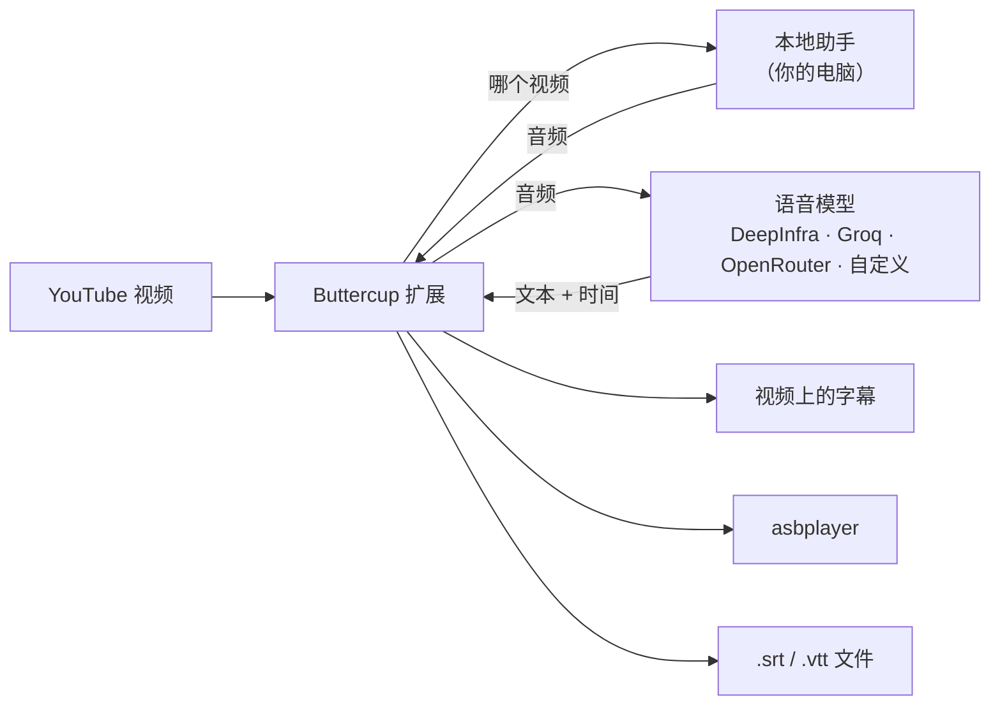

<div align="center">


# Buttercup Revival

**面向 Chromium 和 Gecko 浏览器的按需 YouTube 转录。**

Buttercup Revival 是一款适用于基于 Chromium 的浏览器以及 Firefox、Zen 等 Gecko 浏览器的扩展。
它使用你选择的语音模型转录正在观看的视频的音频，
并将结果作为字幕显示、发送到 [asbplayer](https://github.com/asbplayer/asbplayer)，
或保存为 `.srt` 文件。

[](https://github.com/arrow-poppa/buttercup-revival/actions/workflows/test.yml)
[](https://github.com/arrow-poppa/buttercup-revival/releases/latest)


[English](README.md) · [Português (Brasil)](README.pt-BR.md) · [Español](README.es.md) · [日本語](README.ja.md) · **简体中文** · [繁體中文](README.zh-TW.md)

[安装](#installation) · [Firefox / Zen 指南](docs/zh-CN/GECKO_SETUP.md) · [第一批字幕](#first-subtitles) · [asbplayer](#asbplayer) · [设置](#settings) · [故障排除](#troubleshooting) · [开发者](#developers)


</div>

---

## ✨ 功能

- **为没有字幕的视频**或自动字幕质量较差的视频生成字幕。
- **跟随说话人。** 每条字幕在句末、逗号或换气处结束，让文字随语音出现和消失，而不是固定分块。
- **语音模型由你选择。** DeepInfra、Groq、OpenRouter，或任何兼容 OpenAI 的 API。Whisper、Qwen ASR、Voxtral 等。
- **三种使用结果的方式：** 在 YouTube 播放器上显示字幕、自动发送到 **asbplayer**，或保存为所选文件夹中的 `.srt` / `.vtt` 文件。
- **复用缓存的转录。** 更改字幕布局或再次导出时，无需再次请求提供商。重新生成会明确请求新的转录。
- **本地准备音频。** 助手在你的电脑上准备音频；扩展只把音频和所需的 API 密钥发送给你选择的转录提供商。
- **六种界面语言：** English、Português、Español、日本語、简体中文、繁體中文。

## 🧩 工作原理

Buttercup 由两部分组成，安装程序会将它们一起配置好：

| 部分 | 是什么 | 做什么 |
| --- | --- | --- |
| **扩展** | Chromium 或 Gecko WebExtension | 在 YouTube 播放器中添加 **BC** 按钮，与语音模型通信，显示并导出字幕 |
| **本地助手** | 你电脑上的一个小程序 | 使用 `yt-dlp` 获取视频音频，并用 FFmpeg 进行处理 |



助手只在你请求时运行，并且只接受来自你自己电脑（`127.0.0.1`）的连接。

## 📋 你需要什么

- **Windows 10 或 11**，或 **Linux**。
- **受支持的桌面浏览器：** Chromium 120+（Chrome、Edge、Brave、Vivaldi、Opera、Chromium 及兼容分支），或 Gecko 140+（Firefox、Zen 及兼容的现代分支）。请参阅 [Chromium 兼容性](docs/zh-CN/BROWSERS.md)和 [Firefox / Zen 设置](docs/zh-CN/GECKO_SETUP.md)。
- **一个 API 密钥**（来自语音提供商）。创建一个只需几分钟；请参阅[第 4 步](#step-4)。
- 约 **1 GB** 的可用磁盘空间。

你**不需要**自行安装 Python、Node.js 或 FFmpeg。安装程序会完成这些。

## 🚀 安装

<a id="installation"></a>

先选择适合你的浏览器的方式。原生安装通过浏览器的原生消息传递 API 连接。Zen Flatpak 可以使用可选的 Flatseal 自动启动器，或手动连接文件。

| 浏览器 | 构建 | 设置指南 |
| --- | --- | --- |
| 基于 Chromium | `dist/chromium` | 继续执行下面的步骤 |
| Firefox / Zen / 现代 Gecko 分支 | `dist/firefox` 或 `dist/firefox-unsigned.zip` | [按照 Firefox / Zen 指南操作](docs/zh-CN/GECKO_SETUP.md) |
| Zen Flatpak | Gecko 构建 | [使用 Flatseal 自动连接](docs/zh-CN/GECKO_SETUP.md#flatseal)或[手动连接](docs/zh-CN/GECKO_SETUP.md#manual) |

### 第 1 步 · 下载

1. **[下载 Buttercup（ZIP）](https://github.com/arrow-poppa/buttercup-revival/releases/latest/download/Buttercup-Revival.zip)**。
2. **解压** ZIP：右键单击 → **全部解压缩…**
3. 将解压后的文件夹放在可以长期保留的位置，例如**文档**。

> [!IMPORTANT]
> 扩展从这个文件夹运行。如果你之后移动或删除它，Buttercup 将停止工作。

> [!NOTE]
> 从 **v0.6.0** 开始，发布 ZIP 包含两种浏览器构建：`dist/chromium`、`dist/firefox` 和 `dist/firefox-unsigned.zip`。对于 Firefox/Zen，请遵循 [Gecko 设置指南](docs/zh-CN/GECKO_SETUP.md)，包括你的浏览器对签名的要求。

### 第 2 步 · 运行安装程序

<details open>
<summary><b>Windows</b></summary>

打开文件夹，双击 **`Install Buttercup.cmd`**。

会打开一个窗口，并在运行过程中显示五个步骤。它会下载并安装缺少的内容，
因此首次运行可能需要几分钟。完成后，它会打开第 3 步所需的文件夹。

- 如果 Windows 显示 **“Windows 已保护你的电脑”**，请单击**更多信息** → **仍要运行**。下载的脚本都会出现此提示。
- 如果窗口请求安装 **Node.js** 的权限，请选择**是**。

</details>

<details>
<summary><b>Linux</b></summary>

在文件夹中打开终端并运行：

```sh
sh install.sh
```

它会使用你的包管理器（`apt`、`dnf`、`pacman` 或 `zypper`），仅在安装缺少的软件包时要求输入密码。

如需自动启动，请使用原生浏览器软件包（`.deb` / `.rpm`）。**Snap** 和 **Flatpak** 可能会阻止原生消息传递。Zen Flatpak 用户可以按照[自动或手动连接教程](docs/zh-CN/GECKO_SETUP.md#connect)操作。

</details>

### 第 3 步 · 将扩展添加到浏览器

**Firefox、Zen 和其他现代 Gecko 浏览器：** 请使用[分步安装指南](docs/zh-CN/GECKO_SETUP.md)。其中说明了在 Zen 中永久安装未签名扩展、Firefox 各版本之间的差异，以及两种 Flatpak 连接方法。**Linux 上的 Helium** 使用 Chromium 构建；其原生主机路径已注册，但 Helium 的实时运行验证仍待完成。

**未签名的 Gecko 构建：** 在 `about:config` 中将 `xpinstall.signatures.required` 设为 `false` 后，Zen 可以保留已安装的未签名扩展。标准 Firefox 发行版仍强制要求签名；Firefox ESR、Developer Edition、Nightly、LibreWolf 和 Waterfox 有不同的策略。指南中包含[经验证的签名要求和来源链接](docs/zh-CN/GECKO_SETUP.md#other-browsers)。

以下步骤适用于基于 Chromium 的浏览器。

浏览器只会从商店自动安装扩展，因此这一步需要手动完成。

1. 打开基于 Chromium 的浏览器，在地址栏中输入 **`chrome://extensions`**，然后按 Enter。
2. 打开**开发者模式**（Chrome 在右上角，Edge 在左侧）。
3. 单击**加载已解压的扩展程序**。
4. 选择 Buttercup 文件夹中的 **`dist/chromium`** 文件夹。在 Windows 上，安装程序已经复制了地址：在文件夹窗口中按 **Ctrl + V**，然后单击**选择文件夹**。


Buttercup 现在会出现在列表中。单击工具栏中的拼图图标，并**固定** Buttercup，使其图标保持可见。

### 第 4 步 · 添加 API 密钥

<a id="step-4"></a>

语音模型在提供商处运行，提供商需要密钥来确认请求来自你。

1. 在以下任一提供商处创建账户和密钥：

   | 提供商 | 须知 | 获取密钥 |
   | --- | --- | --- |
   | **Groq** | 有免费额度；速度快 | [console.groq.com/keys](https://console.groq.com/keys) |
   | **DeepInfra** | 按量付费；多种语音模型（Whisper、Qwen ASR、Voxtral） | [deepinfra.com/dash/api_keys](https://deepinfra.com/dash/api_keys) |
   | **OpenRouter** | 一个账户使用多个提供商 | [openrouter.ai/keys](https://openrouter.ai/keys) |

2. 单击浏览器工具栏中的 **Buttercup 图标**。
3. 使用 **Start and connect** 或你选择的 [Flatpak 方法](docs/zh-CN/GECKO_SETUP.md#connect)连接助手。徽标会变为 **Connected**。
4. 在 **Transcription** 下选择提供商并粘贴密钥。


一切都会自动保存。完成。

## 🎬 你的第一批字幕

<a id="first-subtitles"></a>

1. 打开任意 YouTube 视频。
2. 单击播放器控件中的粉色 **BC** 按钮。
3. 紫色通知会显示进度：提取音频、转录、完成。
4. 字幕会显示在视频上。再次单击 **BC** 可隐藏或显示字幕。

首次使用大约需要提供商转录音频所需的时间。之后打开同一视频会立即显示，因为结果已缓存。

> [!TIP]
> 重启电脑后，打开 Buttercup 弹出窗口并单击一次 **Start and connect**。

**你可能会遇到的两种消息**

- *"Human captions are available"*：视频已有由人工编写的字幕。如仍要替换，请在 **General** 下关闭 **Prefer human captions**。
- *"Multiple audio tracks detected"*：视频是配音版本。将 **Audio track for transcription** 设为 **Original audio**。你可以为所有视频保持此设置。

## 📚 与 asbplayer 配合使用

<a id="asbplayer"></a>

Buttercup 可以将字幕直接交给 [asbplayer](https://github.com/asbplayer/asbplayer) 用于语言学习。

两者通过 asbplayer 的 **WebSocket 服务器**通信，这是 asbplayer 项目的一个小程序，运行在你的电脑上。它不属于 Buttercup，安装程序也不会配置它，因此请执行一次以下操作：

**1 · 启动 asbplayer 的 WebSocket 服务器**

安装 [Go](https://go.dev/dl/) 和 [Git](https://git-scm.com/downloads)，然后在终端中运行：

```sh
git clone https://github.com/asbplayer/asbplayer.git
cd asbplayer/scripts/web-socket-server
go run .
```

使用 asbplayer 时请保持该窗口打开。下次只需最后两行。asbplayer 自己的 [WebSocket 服务器指南](https://docs.asbplayer.dev/docs/guides/web-socket-server)中有详细说明和选项。

**2 · 让 asbplayer 连接到它**

打开 asbplayer 的设置，转到 **Misc**，启用 **WebSocket client**。地址保持不变。

**3 · 让 Buttercup 使用它**

在 Buttercup 弹出窗口中，打开 **Integrations · asbplayer**：

- 单击 **Check connected media**，确认 Buttercup 可以访问服务器。
- 打开 **Auto-send subtitles to asbplayer**。
- 如只想查看 asbplayer 的字幕，请在 **General** 下关闭 **Show Buttercup captions on the YouTube video**。

此后，按 **BC** 会生成字幕并加载到 asbplayer。**Send to asbplayer** 按钮可随时再次发送，包括从缓存发送。

## 💾 保存字幕文件

- **Download SRT** / **Download VTT** 保存当前视频的字幕。
- **Save SRT automatically after generating** 会为每个视频自动保存。
- **Folder for subtitle files** 选择保存位置。留空则使用浏览器的下载文件夹，也可以输入完整路径，例如 `D:\Subtitles`。该文件夹必须已经存在。

文件命名为 `[videoID]___Title.srt`，例如 `[dQw4w9WgXcQ]___Never Gonna Give You Up.srt`。较新的文件会替换同名的旧文件。

## 🔧 设置

<a id="settings"></a>

弹出窗口按部分组织。你最可能用到的部分：

| 部分 | 设置 | 作用 |
| --- | --- | --- |
| **Header** | Language | 界面语言。*Auto* 跟随浏览器 |
| **General** | Audio track for transcription | *Original audio* 可避免转录配音 |
| | Show Buttercup captions on the YouTube video | 关闭 = 字幕只发送到 asbplayer 或文件 |
| | Spoken language | 留空以自动检测；如果检测错误，请设置（`ja`、`en`、`pt`…） |
| | Folder for subtitle files | `.srt` / `.vtt` 文件的写入位置 |
| **Transcription** | Provider, key and model | 使用哪个语音模型转录音频 |
| | Request word timestamps | 生成简短、贴合语音的字幕所需。请保持开启 |
| | Vocabulary prompt | 名称和不常见词语，帮助模型正确拼写 |
| **Subtitle layout** | Start a new subtitle | 跟随说话人，或仅在字数上限处切分 |
| | Max words per subtitle | 屏幕上同时显示的文本上限 |
| | Line break every N words | 每 N 个词将一条字幕换行 |
| **Audio upload (advanced)** | Audio sending | *In parts* 适用于任意长度；*Whole audio* 为单次请求 |
| | Audio format | MP3（默认）或 FLAC，按每个提供商/模型配置分别记忆 |
| **Keyboard shortcuts** | Configure shortcuts | 在浏览器的快捷键设置中自定义 Generate 和 Regenerate |
| **Backup** | Export / Import settings | 将设置保存到文件并在以后加载 |

键盘快捷键在弹出窗口关闭时对当前活动的 YouTube 视频生效。默认值：**Alt+Shift+G** 在可用时使用缓存生成；**Alt+Shift+U** 通过向提供商发出新请求重新生成（可能产生费用）。在 Buttercup 中打开 **Keyboard shortcuts → Configure shortcuts** 可重新分配或禁用它们。Chromium 会打开其扩展快捷键页面；Firefox/Zen 会打开 Manage Extension Shortcuts。浏览器将分配单独于设置备份保存，保留或冲突的组合可能保持未分配或被浏览器拦截。物理按键事件已在 Xvfb 下的 Chromium 和 Firefox 中测试，包括 Firefox 的自定义分配；要在隔离的 X11 显示环境中使用 `BUTTERCUP_TEST_SHORTCUTS=1` 运行浏览器测试套件来复现。

在 Buttercup 的分段模式下，当提供商仅返回分段时间戳或将整个短语放在一个词条目中时，字幕字数上限同样适用。在这些情况下，内部字幕边界会在原始片段内估算，完成消息会对此进行说明；真实的词时间戳会保留。日语/中文使用文本字符数，同时保持拉丁词和 Unicode 字素完整。选择 **Start a new subtitle → Keep provider segments (original timing)** 可使用返回的片段边界。这会绕过字数上限；将 **Line break** 设为 **0** 可保留返回的文本布局。未返回片段时，将使用原始的带时间戳词条目。更改布局会重新格式化缓存字幕，而不会调用提供商。**Regenerate subtitles** 会明确绕过本地和社区缓存并请求新的转录（可能产生提供商费用）；请求失败会保留最后缓存的结果。


更改 **Subtitle layout** 永远不会产生费用：它只是重新排列已经转录的词语。

<details>
<summary><b>关于上传大小和长视频</b></summary>

提供商限制单个上传文件的大小。请将 **Max audio chunk (MB)** 保持在提供商的允许范围内；Buttercup 默认使用 24 MB。64 kbps 的 MP3 每分钟约使用 0.48 MB。FLAC 的大小取决于音频，因此相同的上传上限可能对应不同的时长。

对于更长的内容，请将 **Audio sending** 保持为 **In parts**：音频会被切成重叠 1.5 秒的片段，每个片段单独转录，结果在不重复或丢失词语的情况下合并。

</details>

**Audio format** 提供 **MP3 — smaller uploads (default)** 和 **FLAC — lossless encoding, usually larger uploads**。两者都使用 **16 kHz 单声道**音频；MP3 使用 **64 kbps**，FLAC 使用 **16 位采样**。每种格式都直接从下载的源编码。FLAC 避免了额外的有损编码步骤，但无法恢复 YouTube 音频中已经丢失的细节，也不保证更好的转录或时间戳。

Buttercup 会按提供商、API 端点/模式、模型和固定的上游提供商分别记住格式，设置备份中也会包含。现有安装和旧备份默认使用 MP3。两种选项对所有提供商都保持可选。格式是否被接受取决于所选的 API/模型；被拒绝的上传不会用其他格式或其他提供商重试。FLAC 需要更新后的本地助手：更新后请运行安装程序并重启助手。

更改格式会**复用缓存字幕**。选择 **Regenerate subtitles** 可发送以所选格式重新编码的音频；可能产生提供商费用。短样本测试会原样上传你选择的文件，因此请使用已按要测试的格式编码的样本。我们不声称精度有所提高，也未进行付费提供商基准测试。

<details>
<summary><b>关于 Cookie 和受限视频</b></summary>

年龄受限或仅限会员的视频需要你已登录。在 **YouTube Authentication / Cookies** 下，你可以导入从浏览器导出的 `cookies.txt` 文件。仅接受 YouTube 和 Google 的 Cookie，它们会留在你的电脑上。

</details>

对于日语、中文和其他不使用空格的支持文字，字幕布局使用字符数而不是以空格分隔的单词。带时间戳的标记会无人工空格地连接；混合文本中的拉丁词和数字保持完整。换行会保留 Unicode 字素，并将结束标点与前文保持在一起。字幕边界仍遵循提供商的时间戳：作为单个带时间条目返回的长短语可以换成多行，但不会分配虚构的逐字符时间。

## 🌍 语言

界面提供 **English、Português (Brasil)、Español、日本語、简体中文和繁體中文**。在弹出窗口顶部的菜单中选择一种。使用自动语言选择时，台湾、香港、澳门和 `zh-Hant` 浏览器区域设置会使用繁体中文；显式的文字偏好优先于地区。

翻译位于 [`locales/`](locales)，每种语言一个文件，格式为 `"original text": "译文"`。所有源字符串和翻译键均为英文。扩展描述和安装程序始终为英文。没有翻译的文本会按原样显示，因此缺少条目不会破坏任何功能。要添加语言，请复制一个文件、翻译值，并在 [`api/i18n.js`](api/i18n.js) 中注册。

## 🔄 更新

1. 下载[最新 ZIP](https://github.com/arrow-poppa/buttercup-revival/releases/latest/download/Buttercup-Revival.zip)，并将其解压**覆盖同一文件夹**，替换文件。
2. 再次运行安装程序。
3. 打开 `chrome://extensions`，单击 Buttercup 卡片上的**重新加载**箭头。

你的设置会保留在原处。为安全起见，请先使用 **Backup → Export settings**。要恢复备份，请选择 **Backup → Import settings**。Buttercup 会打开一个设置标签页；在那里选择你的 JSON 文件，然后单击 **Import settings**。保持标签页打开，直到导入完成。

所有文件选择都使用这个持久页面：**Test transcription and timestamps**、**Import cookies**、**Open connection editor** 和 **Import settings** 会在标签页中打开相应部分。在那里选择文件，然后单击测试/导入按钮。关闭原始弹出窗口或切换标签页后，所选文件仍可用。打开页面或选择文件不会发送它；音频测试和 Cookie 导入需要你明确提交。除非你在该次导入中启用，否则 Cookie 持久化保持关闭。

## 🧹 卸载

1. **Windows：** 双击 **`Uninstall Buttercup.cmd`**。**Linux：** 运行 `.venv/bin/python scripts/setup-assistant.py --uninstall`。
2. 在 `chrome://extensions` 中移除 **Buttercup Revival**。
3. 删除 Buttercup 文件夹。

Python、Node.js 和 FFmpeg 会保持安装，因为其他程序可能会使用它们。如需删除，请从系统的应用列表中卸载。

## 🛠 故障排除

<a id="troubleshooting"></a>

| 你看到的情况 | 该怎么做 |
| --- | --- |
| 助手徽标显示 **Disconnected** | 原生浏览器和 Flatseal 桥接使用 **Start and connect**。手动 Flatpak 连接使用 **Start Buttercup assistant.sh**，然后使用 **Check connection** |
| 浏览器无法访问本地助手 | 从正确的解压文件夹运行安装程序。对于 Flatpak，请完成[方法 A 或 B](docs/zh-CN/GECKO_SETUP.md#connect)；仅安装附加组件是不够的 |
| 播放器上没有 **BC** 按钮 | 重新加载 YouTube 页面。检查 **Enable Buttercup** 是否已开启 |
| 弹出窗口中显示 **Reload extension** 按钮 | 单击它。扩展在打开期间被更新了 |
| *"Set your … API key first"* | 粘贴 **Transcription** 下所选提供商的密钥 |
| *"YouTube rejected extraction (403)"* 或身份验证失败 | 导入新的 Cookie，或稍后重试；YouTube 有时会暂时阻止下载 |
| 字幕是大块文本 | 选择 Buttercup 分段模式并降低 **Max words per subtitle**。提供商原始分段会绕过该上限。如果没有词时间，内部字幕时间会被估算 |
| *"asbplayer is unavailable"* | 启动 asbplayer 的 WebSocket 服务器并在 asbplayer 中启用 WebSocket 客户端；请参阅[与 asbplayer 配合使用](#asbplayer) |
| 上传因过大而被拒绝 | 使用 **Audio sending → In parts** |
| 安装程序提示某个程序无法安装 | 手动安装它（[Python](https://www.python.org/downloads/)、[Node.js](https://nodejs.org/)、[FFmpeg](https://ffmpeg.org/download.html)），然后再次运行安装程序 |
| 没有任何反应，也没有消息 | 打开弹出窗口：顶部的状态行会显示最后的错误 |

仍然无法解决？请[提交问题](https://github.com/arrow-poppa/buttercup-revival/issues)，并附上你看到的消息和导致问题的步骤。

## 🔒 隐私与安全

- **音频**在你的电脑上下载并转换，然后仅发送给你选择的提供商。
- **API 密钥**存储在扩展的私有存储中，仅发送给该提供商。YouTube 页面永远看不到它们。
- **本地助手**仅接受来自你的电脑、且仅来自此扩展的连接，使用安装时创建的随机令牌。
- **按用户配置助手。** 助手位于 Buttercup 文件夹中，并按用户注册。安装程序可能会使用系统包管理器安装缺少的依赖项；助手没有自动登录启动。
- **无遥测。** 可选的社区缓存默认关闭；启用后，仅共享字幕文本以及视频/模型详情。

设置备份包含你的 API 密钥。请像对待密码一样对待该文件。

## 👩‍💻 面向开发者

<a id="developers"></a>

<details>
<summary><b>项目结构</b></summary>

```
manifest.json, popup.html      扩展清单和弹出窗口
buttercup.js, content.js       播放器按钮、字幕和进度通知（内容脚本）
background/, gecko/            共享处理和 Chromium/Gecko 兼容性
api/                           设置、提供商、转录流水线、i18n
subtitles/, cache/             字幕条目格式化、SRT/VTT 导出、IndexedDB 缓存
integrations/                  asbplayer
locales/                       界面翻译（英文源键）
backend/                       本地助手（FastAPI、yt-dlp、pytubefix、FFmpeg）
scripts/                       安装程序、原生消息桥接、构建和浏览器测试
tests/                         Node 和 pytest 单元测试
docs/                          技术说明、上游分析、验证日志
```

</details>

<details>
<summary><b>构建和测试</b></summary>

需要 Python 3.11+、Node.js 22+ 和 FFmpeg。每次运行安装程序都会要求 pip 将 yt-dlp 和 pytubefix 升级到与已安装的 Python 和依赖要求兼容的最新稳定版本。

```sh
python -m venv .venv
.venv/bin/python -m pip install -r backend/requirements-dev.txt   # Windows: .venv\Scripts\python.exe
npm ci

npm run build                       # 生成 dist/chromium、dist/firefox 和 dist/firefox-unsigned.zip
npm run package                     # 构建发布归档 dist/Buttercup-Revival.zip
npm test                            # JavaScript 单元测试
.venv/bin/python -m pytest tests/backend -q
```

该扩展没有打包器：`npm run build` 复制共享文件并应用少量 Gecko 清单/API/存储适配。安装程序只需要 `node scripts/build.mjs`。请参阅 [Gecko 架构和运行时验证](docs/firefox.md)。

</details>

<details>
<summary><b>设计说明</b></summary>

- **Chromium Manifest V3；Gecko Manifest V2，带有隐藏的持久后台页面。** 无远程代码。字幕使用视频原生的 `TextTrack`。
- **稳定的扩展身份。** Chromium 从清单公钥派生其 ID；Gecko 使用显式附加组件 ID。安装程序会自动注册两者。
- **原生消息桥接**只有一个允许的操作：启动本地服务并返回其配对令牌。
- **提供商请求在失败后从不重试或重新路由**，因此付费请求不会被静默重复。
- 更多细节（葡萄牙语）：[技术说明](docs/TECHNICAL.pt-BR.md)、[相对上游的更改](docs/CHANGES.md)、[验证日志](docs/VALIDATION.md)。

</details>

欢迎贡献。请在提交拉取请求前运行单元测试。

## 🙏 致谢

Buttercup Revival 是 **[iGerman00 的 Buttercup](https://github.com/iGerman00/buttercup-chrome)** 的现代化分支，后者创造了这一想法、名称和外观。如果你觉得它有用，可以考虑[支持原作者](https://github.com/iGerman00)。

基于 [yt-dlp](https://github.com/yt-dlp/yt-dlp)、[pytubefix](https://github.com/JuanBindez/pytubefix)、[FFmpeg](https://ffmpeg.org/) 和 [FastAPI](https://fastapi.tiangolo.com/) 构建。

原项目未声明许可证，此分支也未添加许可证；请参阅 [docs/UPSTREAM.md](docs/UPSTREAM.md)。
