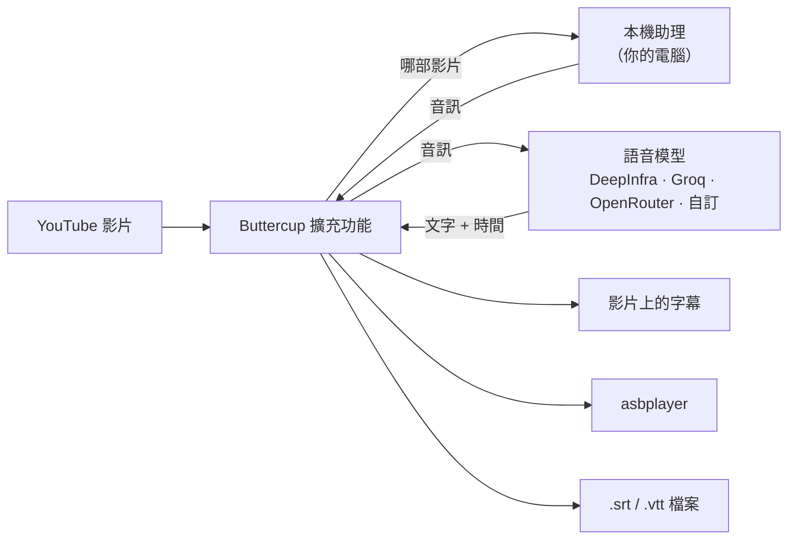

<div align="center">


# Buttercup Revival

**為 Chromium 與 Gecko 瀏覽器提供的隨選 YouTube 轉錄功能。**

Buttercup Revival 是適用於 Chromium 系瀏覽器，以及 Firefox、Zen 等 Gecko 系瀏覽器的擴充功能。
它會使用你選擇的語音模型，轉錄你正在觀看影片的音訊，
並將結果顯示為字幕、傳送到 [asbplayer](https://github.com/asbplayer/asbplayer)，
或儲存為 `.srt` 檔案。

[](https://github.com/arrow-poppa/buttercup-revival/actions/workflows/test.yml)
[](https://github.com/arrow-poppa/buttercup-revival/releases/latest)


[English](README.md) · [Português (Brasil)](README.pt-BR.md) · [Español](README.es.md) · [日本語](README.ja.md) · [简体中文](README.zh-CN.md) · **繁體中文**

[安裝](#installation) · [Firefox / Zen 指南](docs/zh-TW/GECKO_SETUP.md) · [第一批字幕](#first-subtitles) · [asbplayer](#asbplayer) · [設定](#settings) · [疑難排解](#troubleshooting) · [開發人員](#developers)


</div>

---

## ✨ 功能

- **為沒有字幕的影片**，或自動字幕品質不佳的影片產生字幕。
- **跟隨說話者。** 每條字幕會在句末、逗號或換氣處結束，讓文字隨語音出現與消失，而不是固定分塊。
- **語音模型由你選擇。** DeepInfra、Groq、OpenRouter，或任何相容於 OpenAI 的 API。Whisper、Qwen ASR、Voxtral 等。
- **三種使用結果的方式：** 在 YouTube 播放器上顯示字幕、自動傳送到 **asbplayer**，或儲存為所選資料夾中的 `.srt` / `.vtt` 檔案。
- **重複使用快取的轉錄結果。** 變更字幕版面或再次匯出時，無須再次要求供應商。重新產生會明確要求新的轉錄。
- **在本機準備音訊。** 助理會在你的電腦上準備音訊；擴充功能只會將音訊和所需的 API 金鑰傳送給你選擇的轉錄供應商。
- **六種介面語言：** English、Português、Español、日本語、简体中文、繁體中文。

## 🧩 運作方式

Buttercup 由兩個部分組成，安裝程式會將它們一起設定好：

| 部分 | 是什麼 | 做什麼 |
| --- | --- | --- |
| **擴充功能** | Chromium 或 Gecko WebExtension | 在 YouTube 播放器中加入 **BC** 按鈕、與語音模型通訊，並顯示與匯出字幕 |
| **本機助理** | 你電腦上的小型程式 | 使用 `yt-dlp` 取得影片音訊，並以 FFmpeg 處理 |



助理只會在你要求時執行，並且只接受來自你自己電腦（`127.0.0.1`）的連線。

## 📋 你需要什麼

- **Windows 10 或 11**，或 **Linux**。
- **支援的桌面瀏覽器：** Chromium 120+（Chrome、Edge、Brave、Vivaldi、Opera、Chromium 及相容分支），或 Gecko 140+（Firefox、Zen 及相容的現代分支）。請參閱 [Chromium 相容性](docs/zh-TW/BROWSERS.md)與 [Firefox / Zen 設定](docs/zh-TW/GECKO_SETUP.md)。
- **一組 API 金鑰**（來自語音供應商）。建立只需幾分鐘；請參閱[步驟 4](#step-4)。
- 約 **1 GB** 的可用磁碟空間。

你**不需要**自行安裝 Python、Node.js 或 FFmpeg。安裝程式會完成這些工作。

## 🚀 安裝

<a id="installation"></a>

請先選擇適合你瀏覽器的方式。原生安裝會透過瀏覽器的原生訊息傳遞 API 連線。Zen Flatpak 可以使用選用的 Flatseal 自動啟動器，或手動連線檔案。

| 瀏覽器 | 建置 | 設定指南 |
| --- | --- | --- |
| 以 Chromium 為基礎 | `dist/chromium` | 繼續執行下列步驟 |
| Firefox / Zen / 現代 Gecko 分支 | `dist/firefox` 或 `dist/firefox-unsigned.zip` | [依照 Firefox / Zen 指南操作](docs/zh-TW/GECKO_SETUP.md) |
| Zen Flatpak | Gecko 建置 | [使用 Flatseal 自動連線](docs/zh-TW/GECKO_SETUP.md#flatseal)或[手動連線](docs/zh-TW/GECKO_SETUP.md#manual) |

### 步驟 1 · 下載

1. **[下載 Buttercup（ZIP）](https://github.com/arrow-poppa/buttercup-revival/releases/latest/download/Buttercup-Revival.zip)**。
2. **解壓縮** ZIP：按一下右鍵 → **全部解壓縮…**
3. 將解壓縮後的資料夾放在可以長期保留的位置，例如**文件**。

> [!IMPORTANT]
> 擴充功能會從這個資料夾執行。如果你之後移動或刪除它，Buttercup 將停止運作。

> [!NOTE]
> 從 **v0.6.0** 開始，發行 ZIP 包含兩種瀏覽器建置：`dist/chromium`、`dist/firefox` 和 `dist/firefox-unsigned.zip`。若使用 Firefox/Zen，請依照 [Gecko 設定指南](docs/zh-TW/GECKO_SETUP.md)操作，包括你的瀏覽器對簽章的要求。

### 步驟 2 · 執行安裝程式

<details open>
<summary><b>Windows</b></summary>

開啟資料夾，按兩下 **`Install Buttercup.cmd`**。

會開啟一個視窗，並在執行過程中顯示五個步驟。它會下載並安裝缺少的內容，
因此第一次執行可能需要幾分鐘。完成後，它會開啟步驟 3 所需的資料夾。

- 如果 Windows 顯示 **「Windows 已保護您的電腦」**，請按一下**更多資訊** → **仍要執行**。下載的指令碼都會出現此提示。
- 如果視窗要求安裝 **Node.js** 的權限，請選擇**是**。

</details>

<details>
<summary><b>Linux</b></summary>

在資料夾中開啟終端機並執行：

```sh
sh install.sh
```

它會使用你的套件管理員（`apt`、`dnf`、`pacman` 或 `zypper`），僅在安裝缺少的套件時要求輸入密碼。

如需自動啟動，請使用原生瀏覽器套件（`.deb` / `.rpm`）。**Snap** 和 **Flatpak** 可能會封鎖原生訊息傳遞。Zen Flatpak 使用者可以依照[自動或手動連線教學](docs/zh-TW/GECKO_SETUP.md#connect)操作。

</details>

### 步驟 3 · 將擴充功能加入瀏覽器

**Firefox、Zen 和其他現代 Gecko 瀏覽器：** 請使用[逐步安裝指南](docs/zh-TW/GECKO_SETUP.md)。其中說明了在 Zen 中永久安裝未簽署擴充功能、Firefox 各版本之間的差異，以及兩種 Flatpak 連線方法。**Linux 上的 Helium** 使用 Chromium 建置；其原生主機路徑已註冊，但 Helium 的實際執行驗證仍待完成。

**未簽署的 Gecko 建置：** 在 `about:config` 中將 `xpinstall.signatures.required` 設為 `false` 後，Zen 可以保留已安裝的未簽署擴充功能。標準 Firefox 發行版仍強制要求簽章；Firefox ESR、Developer Edition、Nightly、LibreWolf 和 Waterfox 有不同的原則。指南中包含[經驗證的簽章要求與來源連結](docs/zh-TW/GECKO_SETUP.md#other-browsers)。

下列步驟適用於以 Chromium 為基礎的瀏覽器。

瀏覽器只會從商店自動安裝擴充功能，因此這一步需要手動完成。

1. 開啟以 Chromium 為基礎的瀏覽器，在位址列輸入 **`chrome://extensions`**，然後按 Enter。
2. 開啟**開發人員模式**（Chrome 在右上角，Edge 在左側）。
3. 按一下**載入未封裝項目**。
4. 選擇 Buttercup 資料夾中的 **`dist/chromium`** 資料夾。在 Windows 上，安裝程式已經複製了位址：在資料夾視窗中按 **Ctrl + V**，然後按一下**選擇資料夾**。


Buttercup 現在會出現在清單中。按一下工具列中的拼圖圖示，並**釘選** Buttercup，讓其圖示保持可見。

### 步驟 4 · 加入你的 API 金鑰

<a id="step-4"></a>

語音模型在供應商端執行，供應商需要金鑰來確認要求來自你。

1. 在下列任一供應商建立帳戶與金鑰：

   | 供應商 | 須知 | 取得金鑰 |
   | --- | --- | --- |
   | **Groq** | 有免費額度；速度快 | [console.groq.com/keys](https://console.groq.com/keys) |
   | **DeepInfra** | 依用量計費；多種語音模型（Whisper、Qwen ASR、Voxtral） | [deepinfra.com/dash/api_keys](https://deepinfra.com/dash/api_keys) |
   | **OpenRouter** | 一個帳戶使用多個供應商 | [openrouter.ai/keys](https://openrouter.ai/keys) |

2. 按一下瀏覽器工具列中的 **Buttercup 圖示**。
3. 使用 **啟動並連線** 或你選擇的 [Flatpak 方法](docs/zh-TW/GECKO_SETUP.md#connect)連接助理。徽章會變成 **已連線**。
4. 在 **轉錄** 下選擇供應商並貼上金鑰。


一切都會自動儲存。完成。

## 🎬 你的第一批字幕

<a id="first-subtitles"></a>

1. 開啟任意 YouTube 影片。
2. 按一下播放器控制項中的粉紅色 **BC** 按鈕。
3. 紫色通知會顯示進度：擷取音訊、轉錄、完成。
4. 字幕會顯示在影片上。再次按一下 **BC** 可隱藏或顯示字幕。

第一次使用大約需要供應商轉錄音訊所需的時間。之後開啟同一部影片會立即顯示，因為結果已快取。

> [!TIP]
> 重新啟動電腦後，開啟 Buttercup 彈出式視窗並按一下 **啟動並連線** 一次。

**你可能會遇到的兩種訊息**

- *"Human captions are available"*：影片已有由人工撰寫的字幕。如仍要取代，請在 **常規** 下關閉 **優先使用人工字幕**。
- *"Multiple audio tracks detected"*：影片是配音版本。將 **用於轉錄的音軌** 設為 **原始音訊**。你可以為所有影片保持此設定。

## 📚 與 asbplayer 搭配使用

<a id="asbplayer"></a>

Buttercup 可以將字幕直接交給 [asbplayer](https://github.com/asbplayer/asbplayer) 用於語言學習。

兩者透過 asbplayer 的 **WebSocket 伺服器**通訊，這是 asbplayer 專案的小型程式，執行在你的電腦上。它不屬於 Buttercup，安裝程式也不會設定它，因此請執行一次下列操作：

**1 · 啟動 asbplayer 的 WebSocket 伺服器**

安裝 [Go](https://go.dev/dl/) 和 [Git](https://git-scm.com/downloads)，然後在終端機中執行：

```sh
git clone https://github.com/asbplayer/asbplayer.git
cd asbplayer/scripts/web-socket-server
go run .
```

使用 asbplayer 時請保持該視窗開啟。下次只需最後兩行。asbplayer 自己的 [WebSocket 伺服器指南](https://docs.asbplayer.dev/docs/guides/web-socket-server)中有詳細說明與選項。

**2 · 讓 asbplayer 連線到它**

開啟 asbplayer 的設定，前往 **Misc**，啟用 **WebSocket client**。位址保持不變。

**3 · 讓 Buttercup 使用它**

在 Buttercup 彈出式視窗中，開啟 **整合 · asbplayer**：

- 按一下 **檢查已連線的媒體**，確認 Buttercup 可以連線到伺服器。
- 開啟 **自動將字幕傳送到 asbplayer**。
- 如只想查看 asbplayer 的字幕，請在 **常規** 下關閉 **在 YouTube 影片上顯示 Buttercup 字幕**。

此後，按下 **BC** 會產生字幕並載入 asbplayer。**傳送到 asbplayer** 按鈕可隨時再次傳送，包括從快取傳送。

## 💾 儲存字幕檔案

- **下載 SRT** / **下載 VTT** 會儲存目前影片的字幕。
- **生成後自動儲存 SRT** 會為每部影片自動儲存。
- **字幕檔案的儲存資料夾（留空 = 瀏覽器下載目錄）** 選擇儲存位置。留空則使用瀏覽器的下載資料夾，也可以輸入完整路徑，例如 `D:\Subtitles`。該資料夾必須已經存在。

檔案命名為 `[videoID]___Title.srt`，例如 `[dQw4w9WgXcQ]___Never Gonna Give You Up.srt`。較新的檔案會取代同名的舊檔案。

## 🔧 設定

<a id="settings"></a>

彈出式視窗依區段組織。你最可能用到的區段：

| 區段 | 設定 | 作用 |
| --- | --- | --- |
| **Header** | 語言 | 介面語言。*自動* 跟隨瀏覽器 |
| **常規** | 用於轉錄的音軌 | *原始音訊* 可避免轉錄配音 |
| | 在 YouTube 影片上顯示 Buttercup 字幕 | 關閉 = 字幕只傳送到 asbplayer 或檔案 |
| | 語音語言（留空 = 自動） | 留空以自動偵測；如果偵測錯誤，請設定（`ja`、`en`、`pt`…） |
| | 字幕檔案的儲存資料夾（留空 = 瀏覽器下載目錄） | `.srt` / `.vtt` 檔案的寫入位置 |
| **轉錄** | Provider, key and model | 使用哪個語音模型轉錄音訊 |
| | 請求單字時間戳記 | 產生簡短、貼合語音的字幕所需。請保持開啟 |
| | 詞彙提示 | 名稱和不常見詞彙，協助模型正確拼寫 |
| **字幕版面配置** | 開始新字幕的時機 | 跟隨說話者，或僅在字數上限處切分 |
| | 每條字幕的最大單字數 | 畫面上同時顯示的文字上限 |
| | 每 N 個單字換行（0 = 單行） | 每 N 個字將一條字幕換行 |
| **音訊上傳（高階）** | 音訊傳送方式 | *分段傳送（適用於長影片）* 適用於任意長度；*整段音訊（單次請求）* 為單次要求 |
| | 音訊格式 | MP3（預設）或 FLAC，依每個供應商/模型設定分別記住 |
| **鍵盤快捷鍵** | 設定快捷鍵 | 在瀏覽器的快速鍵設定中自訂 Generate 與 Regenerate |
| **備份** | Export / Import settings | 將設定儲存到檔案並在之後載入 |

鍵盤快速鍵會在彈出式視窗關閉時對目前作用中的 YouTube 影片生效。預設值：**Alt+Shift+G** 在可用時使用快取產生；**Alt+Shift+U** 透過向供應商發出新要求重新產生（可能產生費用）。在 Buttercup 中開啟 **鍵盤快捷鍵 → 設定快捷鍵** 可重新指派或停用它們。Chromium 會開啟其擴充功能快速鍵頁面；Firefox/Zen 會開啟 Manage Extension Shortcuts。瀏覽器會將指派與設定備份分開儲存，保留或衝突的組合可能維持未指派或被瀏覽器攔截。實體按鍵事件已在 Xvfb 下的 Chromium 與 Firefox 中測試，包括 Firefox 的自訂指派；若要在隔離的 X11 顯示環境中使用 `BUTTERCUP_TEST_SHORTCUTS=1` 執行瀏覽器測試套件來重現。

在 Buttercup 的分段模式下，當供應商僅傳回分段時間戳，或將整個詞組放在單一字詞項目中時，字幕字數上限同樣適用。在這些情況下，內部字幕邊界會在原始片段內估算，完成訊息會說明這一點；實際的字詞時間戳會保留。日語/中文使用文字字元數，同時保持拉丁字母單字和 Unicode 字素完整。選擇 **開始新字幕的時機 → 保留供應商分段（原始時間）** 可使用傳回的片段邊界。這會略過字數上限；將 **每 N 個單字換行（0 = 單行）** 設為 **0** 可保留傳回的文字版面。未傳回片段時，會使用原始的帶時間戳字詞項目。變更版面會重新格式化快取字幕，而不會呼叫供應商。**重新生成字幕** 會明確略過本機與社群快取並要求新的轉錄（可能產生供應商費用）；要求失敗會保留最後快取的結果。


變更 **字幕版面配置** 永遠不會產生費用：它只是重新排列已經轉錄的字詞。

<details>
<summary><b>關於上傳大小與長影片</b></summary>

供應商會限制單一上傳檔案的大小。請將 **單次上傳的最大大小（MB）** 保持在供應商允許的範圍內；Buttercup 預設為 24 MB。64 kbps 的 MP3 每分鐘約使用 0.48 MB。FLAC 的大小取決於音訊，因此相同的上傳上限可能對應不同的長度。

對於更長的內容，請將 **音訊傳送方式** 保持在 **分段傳送（適用於長影片）**：音訊會切成重疊 1.5 秒的片段，每個片段分別轉錄，結果會在不重複或遺漏字詞的情況下合併。

</details>

**音訊格式** 提供 **MP3 — 上傳檔案更小（預設）** 與 **FLAC — 無損編碼，上傳檔案通常更大**。兩者都使用 **16 kHz 單聲道**音訊；MP3 使用 **64 kbps**，FLAC 使用 **16 位元取樣**。每種格式都直接從下載的來源編碼。FLAC 可避免額外的有損編碼步驟，但無法復原 YouTube 音訊中已經遺失的細節，也不保證更好的轉錄或時間戳。

Buttercup 會依供應商、API 端點/模式、模型和固定的上游供應商分別記住格式，設定備份中也會包含。現有安裝和舊備份預設使用 MP3。兩種選項對所有供應商都保持可選。格式是否被接受取決於所選的 API/模型；被拒絕的上傳不會以其他格式或其他供應商重試。FLAC 需要更新後的本機助理：更新後請執行安裝程式並重新啟動助理。

變更格式會**重複使用快取字幕**。選擇 **重新生成字幕** 可傳送以所選格式重新編碼的音訊；可能產生供應商費用。短樣本測試會原樣上傳你選擇的檔案，因此請使用已按要測試的格式編碼的樣本。我們不聲稱準確度有所提升，也未進行付費供應商基準測試。

<details>
<summary><b>關於 Cookie 與受限影片</b></summary>

年齡受限或僅限會員的影片需要你已登入。在 **YouTube 身份驗證 / Cookie** 下，你可以匯入從瀏覽器匯出的 `cookies.txt` 檔案。僅接受 YouTube 和 Google 的 Cookie，它們會留在你的電腦上。

</details>

對於日語、中文和其他不使用空格的支援文字，字幕版面使用字元數而不是以空格分隔的字詞。帶時間戳的權杖會無人工空格地連接；混合文字中的拉丁字母單字和數字保持完整。換行會保留 Unicode 字素，並將結束標點與前文保持在一起。字幕邊界仍遵循供應商的時間戳：以單一帶時間項目傳回的長詞組可以換成多行，但不會指派虛構的逐字元時間。

## 🌍 語言

介面提供 **English、Português (Brasil)、Español、日本語、简体中文和繁體中文**。在彈出式視窗頂端的選單中選擇一種。使用自動語言選擇時，台灣、香港、澳門和 `zh-Hant` 瀏覽器地區設定會使用繁體中文；明確的文字偏好優先於地區。

翻譯位於 [`locales/`](locales)，每種語言一個檔案，格式為 `"original text": "譯文"`。所有來源字串和翻譯鍵均為英文。擴充功能說明和安裝程式一律為英文。沒有翻譯的文字會依原樣顯示，因此缺少項目不會破壞任何功能。若要新增語言，請複製一個檔案、翻譯值，並在 [`api/i18n.js`](api/i18n.js) 中註冊。

## 🔄 更新

1. 下載[最新 ZIP](https://github.com/arrow-poppa/buttercup-revival/releases/latest/download/Buttercup-Revival.zip)，並將其解壓縮**覆蓋同一個資料夾**，取代檔案。
2. 再次執行安裝程式。
3. 開啟 `chrome://extensions`，按一下 Buttercup 卡片上的**重新載入**箭頭。

你的設定會保留在原處。為安全起見，請先使用 **備份 → 匯出設定**。若要還原備份，請選擇 **備份 → 匯入設定**。Buttercup 會開啟設定分頁；在其中選擇你的 JSON 檔案，然後按一下 **匯入設定**。請保持分頁開啟，直到匯入完成。

所有檔案選擇都使用這個持續存在的頁面：**測試轉錄和時間戳記**、**匯入 Cookie**、**開啟連線編輯器** 和 **匯入設定** 會在分頁中開啟相應區段。在那裡選擇檔案，然後按一下測試/匯入按鈕。關閉原始彈出式視窗或切換分頁後，所選檔案仍可使用。開啟頁面或選擇檔案不會傳送它；音訊測試和 Cookie 匯入需要你明確提交。除非你在該次匯入中啟用，否則 Cookie 持續保存保持關閉。

## 🧹 解除安裝

1. **Windows：** 按兩下 **`Uninstall Buttercup.cmd`**。**Linux：** 執行 `.venv/bin/python scripts/setup-assistant.py --uninstall`。
2. 在 `chrome://extensions` 中移除 **Buttercup Revival**。
3. 刪除 Buttercup 資料夾。

Python、Node.js 和 FFmpeg 會保持安裝，因為其他程式可能會使用它們。如需移除，請從系統的應用程式清單中解除安裝。

## 🛠 疑難排解

<a id="troubleshooting"></a>

| 你看到的情況 | 該怎麼做 |
| --- | --- |
| 助理徽章顯示 **未連線** | 原生瀏覽器和 Flatseal 橋接使用 **啟動並連線**。手動 Flatpak 連線使用 **Start Buttercup assistant.sh**，然後使用 **檢查連線** |
| 瀏覽器無法連線到本機助理 | 從正確的解壓縮資料夾執行安裝程式。若使用 Flatpak，請完成[方法 A 或 B](docs/zh-TW/GECKO_SETUP.md#connect)；僅安裝附加元件並不足夠 |
| 播放器上沒有 **BC** 按鈕 | 重新載入 YouTube 頁面。檢查 **啟用 Buttercup** 是否已開啟 |
| 彈出式視窗中顯示 **重新載入擴充功能** 按鈕 | 按一下它。擴充功能在開啟期間被更新了 |
| *"Set your … API key first"* | 貼上 **轉錄** 下所選供應商的金鑰 |
| *"YouTube rejected extraction (403)"* 或驗證失敗 | 匯入新的 Cookie，或稍後再試；YouTube 有時會暫時封鎖下載 |
| 字幕是巨大的文字區塊 | 選擇 Buttercup 分段模式並降低 **每條字幕的最大單字數**。供應商原始分段會略過該上限。如果沒有字詞時間，內部字幕時間會被估算 |
| *"asbplayer is unavailable"* | 啟動 asbplayer 的 WebSocket 伺服器並在 asbplayer 中啟用 WebSocket 用戶端；請參閱[與 asbplayer 搭配使用](#asbplayer) |
| 上傳因過大而被拒絕 | 使用 **音訊傳送方式 → In parts** |
| 安裝程式表示某個程式無法安裝 | 手動安裝它（[Python](https://www.python.org/downloads/)、[Node.js](https://nodejs.org/)、[FFmpeg](https://ffmpeg.org/download.html)），然後再次執行安裝程式 |
| 沒有任何反應，也沒有訊息 | 開啟彈出式視窗：頂端的狀態列會顯示最後的錯誤 |

仍然無法解決？請[提出問題](https://github.com/arrow-poppa/buttercup-revival/issues)，並附上你看到的訊息和導致問題的步驟。

## 🔒 隱私與安全性

- **音訊**會在你的電腦上下載並轉換，然後僅傳送給你選擇的供應商。
- **API 金鑰**儲存在擴充功能的私人儲存空間中，僅傳送給該供應商。YouTube 頁面永遠看不到它們。
- **本機助理**僅接受來自你的電腦、且僅來自此擴充功能的連線，並使用安裝時建立的隨機權杖。
- **依使用者設定助理。** 助理位於 Buttercup 資料夾中，並依使用者註冊。安裝程式可能會使用系統套件管理員安裝缺少的相依項目；助理沒有自動登入啟動。
- **無遙測。** 選用的社群快取預設關閉；啟用後，僅分享字幕文字與影片/模型詳細資料。

設定備份包含你的 API 金鑰。請將該檔案視為密碼。

## 👩‍💻 開發人員

<a id="developers"></a>

<details>
<summary><b>專案結構</b></summary>

```
manifest.json, popup.html      擴充功能資訊清單與彈出式視窗
buttercup.js, content.js       播放器按鈕、字幕與進度通知（內容指令碼）
background/, gecko/            共用處理與 Chromium/Gecko 相容性
api/                           設定、供應商、轉錄管線、i18n
subtitles/, cache/             字幕項目格式化、SRT/VTT 匯出、IndexedDB 快取
integrations/                  asbplayer
locales/                       介面翻譯（英文來源鍵）
backend/                       本機助理（FastAPI、yt-dlp、pytubefix、FFmpeg）
scripts/                       安裝程式、原生訊息橋接、建置與瀏覽器測試
tests/                         Node 與 pytest 單元測試
docs/                          技術說明、上游分析、驗證記錄
```

</details>

<details>
<summary><b>建置與測試</b></summary>

需要 Python 3.11+、Node.js 22+ 和 FFmpeg。每次執行安裝程式都會要求 pip 將 yt-dlp 和 pytubefix 升級到與已安裝的 Python 和相依性要求相容的最新穩定版本。

```sh
python -m venv .venv
.venv/bin/python -m pip install -r backend/requirements-dev.txt   # Windows: .venv\Scripts\python.exe
npm ci

npm run build                       # 產生 dist/chromium、dist/firefox 和 dist/firefox-unsigned.zip
npm run package                     # 建置發行封存檔 dist/Buttercup-Revival.zip
npm test                            # JavaScript 單元測試
.venv/bin/python -m pytest tests/backend -q
```

此擴充功能沒有打包器：`npm run build` 會複製共用檔案並套用少量 Gecko 資訊清單/API/儲存空間調適。安裝程式只需要 `node scripts/build.mjs`。請參閱 [Gecko 架構與實際執行驗證](docs/firefox.md)。

</details>

<details>
<summary><b>設計說明</b></summary>

- **Chromium Manifest V3；Gecko Manifest V2，附隱藏的持續背景頁面。** 無遠端程式碼。字幕使用影片原生的 `TextTrack`。
- **穩定的擴充功能身分。** Chromium 從資訊清單公開金鑰衍生其 ID；Gecko 使用明確的附加元件 ID。安裝程式會自動註冊兩者。
- **原生訊息橋接**只有一個允許的動作：啟動本機服務並傳回其配對權杖。
- **供應商要求在失敗後絕不重試或重新路由**，因此付費要求不會被無聲重複。
- 更多細節（葡萄牙語）：[技術說明](docs/TECHNICAL.pt-BR.md)、[相對上游的變更](docs/CHANGES.md)、[驗證記錄](docs/VALIDATION.md)。

</details>

歡迎貢獻。請在提出提取要求前執行單元測試。

## 🙏 致謝

Buttercup Revival 是 **[iGerman00 的 Buttercup](https://github.com/iGerman00/buttercup-chrome)** 的現代化分支，後者創造了這個想法、名稱與外觀。如果你覺得它有用，可以考慮[支持原作者](https://github.com/iGerman00)。

以 [yt-dlp](https://github.com/yt-dlp/yt-dlp)、[pytubefix](https://github.com/JuanBindez/pytubefix)、[FFmpeg](https://ffmpeg.org/) 和 [FastAPI](https://fastapi.tiangolo.com/) 為基礎建置。

原專案未宣告授權條款，此分支也未新增；請參閱 [docs/UPSTREAM.md](docs/UPSTREAM.md)。
